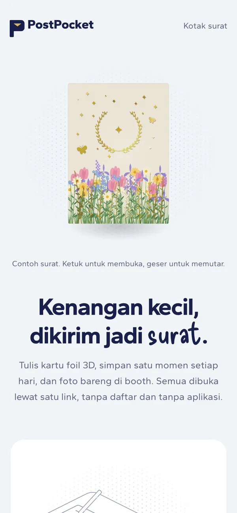
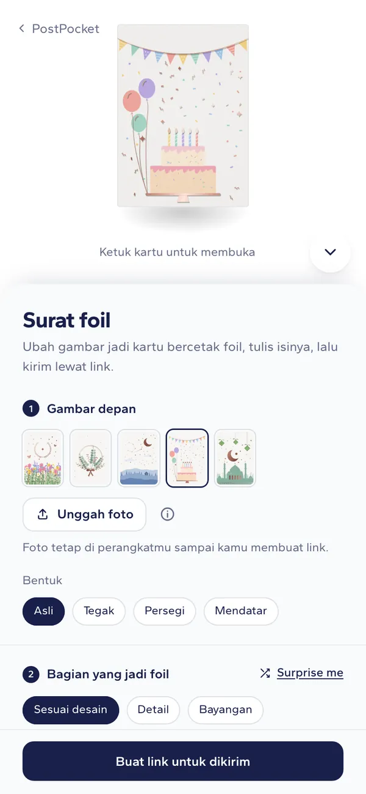
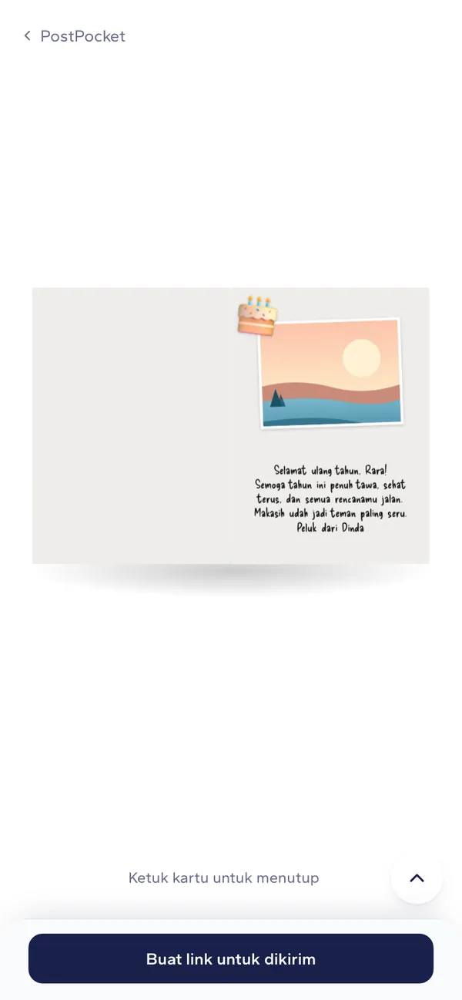
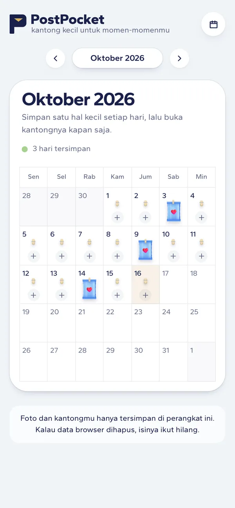
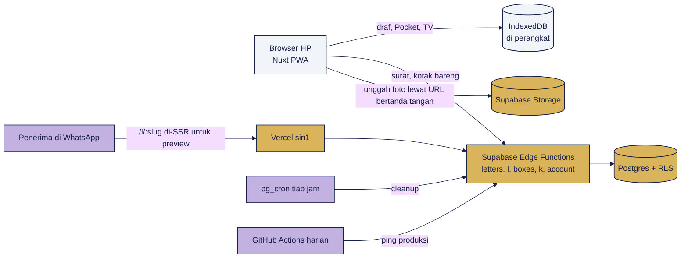

<!-- markdownlint-disable MD013 MD033 MD041 -->

<div align="center">


# PostPocket

**Kenangan kecil, dikirim jadi surat.**

Tulis kartu foil 3D, simpan satu momen setiap hari, dan foto bareng di booth.<br />
Semua dibuka lewat satu link, tanpa daftar dan tanpa aplikasi.

### [Coba di postpocket.vercel.app](https://postpocket.vercel.app)

[](https://postpocket.vercel.app)
[](https://github.com/HaikalFaruq/PostPocket/actions/workflows/web.yml)
[](#fitur)
[](https://nuxt.com)
[](https://supabase.com)
[](https://tailwindcss.com)

</div>

> [!NOTE]
> **PostPocket 1.0 sudah rilis di [postpocket.vercel.app](https://postpocket.vercel.app) sejak 16 Oktober 2026.**
> Vercel men-deploy `main` ke produksi. Surat yang dikirim disimpan Supabase di Sydney; Pocket, TV, dan Booth tetap di perangkat pengguna.

<table>
  <tr>
    <td align="center"></td>
    <td align="center"></td>
    <td align="center"></td>
    <td align="center"></td>
  </tr>
  <tr>
    <td align="center"><b>Beranda</b><br /><sub>Contoh surat yang bisa dibuka</sub></td>
    <td align="center"><b>Surat foil</b><br /><sub>Lima desain di setiap bentuk</sub></td>
    <td align="center"><b>Isi surat</b><br /><sub>Foto, tulisan tangan, stiker</sub></td>
    <td align="center"><b>Pocket</b><br /><sub>Satu kantong setiap hari</sub></td>
  </tr>
</table>

## Kenapa PostPocket

Foto di galeri HP jarang dibuka lagi, dan ucapan di chat cepat tenggelam. PostPocket mengubah satu momen jadi benda: kartu bercetak foil yang bisa diputar, dibuka, dan dibaca seperti surat sungguhan. Penerimanya cukup mengetuk satu link di WhatsApp, tanpa daftar dan tanpa memasang aplikasi.

## Fitur

- **Surat foil 3D.** Lima desain siap pakai (Padang bunga, Ranting, Malam berbintang, Ulang tahun, Lebaran) yang digambar ulang untuk setiap bentuk kartu, atau foto sendiri. Foil bisa mengikuti desain, garis gambar, bagian gelap, atau satu warna, dengan enam warna foil, enam kertas, dan bingkai foil.
- **Isi surat yang selalu rapi.** Empat template, tulisan tangan, foto, dan stiker. Tulisan panjang mengecil sendiri sampai muat, bingkai foto mengikuti bentuk fotonya, dan tidak ada yang saling menimpa atau keluar halaman.
- **Kirim lewat satu link.** Preview muncul di WhatsApp, penerima bisa membalas, dan surat bisa disimpan di Kotak surat perangkatnya. Surat berlaku 30 hari; foto di dalamnya dihapus 7 hari setelah surat pertama kali dibuka.
- **Kotak bareng.** Banyak teman menitip surat untuk satu orang, lalu kotaknya dibuka sekaligus di jadwal yang dipilih.
- **Pocket.** Kalender bulanan: setiap hari diisi foto lalu dibungkus kantong jajan berstiker. Album bulanannya bisa diputar di TV.
- **TV dan Booth.** TV clay jadul dengan rak CD dan filter retro, plus photobooth yang menghasilkan strip foto.
- **Cadangan opsional.** Masuk dengan Google untuk mencadangkan Pocket (maksimal 100 foto per akun) dan membukanya di HP lain. Surat tetap bisa dibuat tanpa akun.
- **PWA.** Bisa dipasang di layar utama, dan editor surat, Pocket, serta TV tetap jalan tanpa internet.

## Cara pakai

1. Buka [Tulis surat](https://postpocket.vercel.app/letter/new), pilih gambar depan dan bentuk kartu, atau unggah foto sendiri.
2. Atur bagian yang jadi foil, warna foil, dan kertas. Kartunya berubah langsung dan bisa diputar.
3. Pilih template isi, tulis pesannya, lalu tambahkan foto dan stiker lewat **Atur foto dan stiker**.
4. Ketuk **Buat link untuk dikirim**, lalu bagikan link-nya.
5. Penerima mengetuk kartunya untuk membuka, membaca lebih besar, membalas, atau menyimpannya.

## Cara kerja



- **Kartu foil tanpa WebGL.** Kartunya CSS 3D, dan lapisan foilnya mask dari ilustrasi atau peta yang dihitung dari foto di browser ([keputusan](docs/spikes/foil-3d.md)).
- **Server hanya untuk yang dikirim.** Pocket, TV, Booth, dan draf surat ada di IndexedDB. Server menyimpan surat yang dibuat link-nya, kotak bareng, dan cadangan Pocket yang dinyalakan pengguna.
- **Foto tidak lewat server aplikasi.** Foto diputar sesuai EXIF, diperkecil, dan disimpan ulang di browser (metadata lokasi ikut hilang), lalu diunggah langsung ke Storage lewat URL bertanda tangan.
- **Kontrak dulu.** Semua endpoint ada di [`docs/api/openapi.yaml`](docs/api/openapi.yaml). Edge Functions dan mock API untuk development memvalidasi body dengan skema yang sama.
- **Bersih sendiri.** Job tiap jam menghapus surat yang lewat 30 hari, foto yang lewat 7 hari setelah dibuka, dan berkas yang tidak dipakai lagi.

## Mulai lokal

Butuh Node.js 24 (`.nvmrc`) dan pnpm 9.

```sh
git clone https://github.com/HaikalFaruq/PostPocket.git
cd PostPocket
pnpm install                                # sekalian mengaktifkan hook git
cp apps/web/.env.example apps/web/.env      # lalu aktifkan NUXT_MOCK_API dan NUXT_PUBLIC_API_BASE
pnpm dev                                    # http://localhost:3000
```

Dengan mock API, alur kirim dan buka surat jalan tanpa Supabase. Untuk mencoba dari HP di jaringan yang sama, jalankan `pnpm dev --host`. Halaman alat uji `/lab` (komponen bersama, kartu foil, cek Safari, alur kirim) hanya ada di development dan build E2E.

| Perintah | Fungsi |
| --- | --- |
| `pnpm dev` | Server development frontend (`apps/web`) |
| `pnpm lint` | ESLint (warning dianggap gagal) dan Prettier |
| `pnpm typecheck` | Cek tipe semua package |
| `pnpm test` | Unit test Vitest semua package |
| `pnpm test:e2e` | E2E Playwright di build production (Android, iPhone, desktop) |
| `pnpm check` | `lint`, `typecheck`, dan `test` sekaligus |

Pertama kali menjalankan E2E di mesin baru: `pnpm --filter @postpocket/web exec playwright install chromium webkit`. Perintah backend (Supabase CLI, pgTAP, Deno) ada di [AGENTS.md](AGENTS.md#6-perintah).

## Struktur

```text
PostPocket/
├── apps/web/              # Nuxt 4: halaman, kartu foil, editor surat, Pocket, TV, Booth, PWA
│   ├── app/               # pages, components, composables, stores, utils
│   ├── server/            # mock API untuk development dan E2E (404 di produksi)
│   ├── public/            # ilustrasi, stiker, ikon, gambar OG
│   ├── scripts/           # generator ilustrasi, ikon, gambar OG, dan cek preview link
│   ├── test/              # unit test Vitest
│   └── e2e/               # skenario Playwright
├── packages/presets/      # pilihan desain dalam JSON + helper tata letak isi surat
├── supabase/
│   ├── migrations/        # skema SQL dan RLS
│   ├── functions/         # Edge Functions Deno beserta test-nya
│   └── tests/database/    # test pgTAP
├── docs/                  # PRD, panduan frontend dan backend, desain, aset, kontrak API
└── AGENTS.md              # aturan kerja untuk manusia dan AI agent
```

## Gerbang mutu

CI di GitHub Actions jalan di setiap PR dan setiap push ke `main`:

| Workflow | Isi |
| --- | --- |
| **Web** | Lint, typecheck, unit test (Vitest), dan E2E Playwright di Android, iPhone, dan desktop pada build production. Sinkron Pocket diuji ke stack Supabase lokal. |
| **Backend** | Lint skema, test pgTAP, lint kontrak OpenAPI, serta lint dan test Edge Functions. Jalan kalau `supabase/`, kontrak, atau preset berubah. |
| **No AI attribution** | Menolak atribusi AI di commit dan PR. Juga dicek hook `commit-msg` dan `pre-push`. |
| **Ping produksi** | Setiap hari pukul 08:17 WIB memastikan fungsi produksi menjawab, supaya proyek Supabase Free tidak di-pause dan gangguan langsung ketahuan lewat email. |

Perilaku baru wajib disertai test: logika di unit test, alur pengguna di E2E. Tampilan dicek di HP 320 px sampai desktop, dan efek 3D dicek di Safari sungguhan.

## Keamanan dan privasi

- **Tanpa rahasia di repo.** Hook `pre-commit` menolak berkas `.env` dan pola secret; secret scanning dan push protection GitHub menyala. Frontend hanya memakai URL Supabase dan publishable key.
- **Akses data dibatasi di database.** Semua tabel memakai RLS, dan pengubahan surat atau kotak butuh token yang hanya dipegang pembuatnya. CORS Edge Functions hanya menerima domain produksi.
- **Header keamanan.** Halaman tidak bisa dibingkai situs lain, jenis berkas tidak ditebak browser, dan hanya kamera (untuk Booth) yang boleh dipakai.
- **Data seperlunya.** Tidak ada cookie pelacak atau analitik pihak ketiga, dan fungsi server tidak mencatat alamat IP. Hitungan surat disimpan tanpa menunjuk surat yang mana. Rinciannya ada di [halaman Privasi](https://postpocket.vercel.app/privasi).
- **Melaporkan celah keamanan.** Pakai [private vulnerability reporting](https://github.com/HaikalFaruq/PostPocket/security/advisories/new), bukan issue publik.

## Deploy

| Bagian | Di mana | Catatan |
| --- | --- | --- |
| Frontend | Vercel, region fungsi `sin1` | Root `apps/web`. Env: `NUXT_PUBLIC_SUPABASE_URL`, `NUXT_PUBLIC_SUPABASE_PUBLISHABLE_KEY`, `NUXT_PUBLIC_KOTAK_BARENG=1` |
| Database dan Storage | Supabase, Sydney (`ap-southeast-2`) | Migrasi lewat `supabase db push`; migrasi yang sudah diterapkan tidak pernah diedit |
| Edge Functions | Supabase | `supabase functions deploy letters l boxes k cleanup account`; deploy ulang `letters` setiap id preset berubah |
| Login | Google OAuth lewat Supabase Auth | Client OAuth sudah In production |

Langkah lengkapnya ada di [docs/frontend.md](docs/frontend.md#deploy) dan [docs/backend.md](docs/backend.md).

## Dokumentasi

| Dokumen | Isi |
| --- | --- |
| [PRD](docs/prd/PRD-PostPocket.md) | Sumber kebenaran produk: modul, alur, keputusan |
| [Panduan frontend](docs/frontend.md) | Cara menjalankan, aturan token dan preset, komponen bersama, PWA, uji di HP |
| [Panduan backend](docs/backend.md) | Data model, endpoint, keamanan, analitik, rencana fase 2 |
| [Identitas visual](docs/desain.md) | Warna, huruf, logo, splash, dan aturan desain |
| [Aset dan lisensi](docs/assets.md) | Sumber dan lisensi setiap aset |
| [Kontrak API](docs/api/openapi.yaml) | OpenAPI semua endpoint |

## Berkontribusi

Alur kerja lengkapnya ada di [`AGENTS.md`](AGENTS.md). Ringkasnya:

1. Sinkron dulu (`git switch main && git pull`), lalu pastikan `git config core.hooksPath` mengeluarkan `.githooks`.
2. Buat branch `feat/…`, `fix/…`, atau `docs/…`, satu topik per PR. `main` hanya menerima PR.
3. Commit memakai Conventional Commits dalam Bahasa Indonesia, dengan pasangan sebagai co-author dan tanpa atribusi AI.
4. Deskripsi PR memakai bagian Apa yang berubah, Kenapa, Sudah dicek, dan Selanjutnya.
5. Setelah CI hijau, merge dengan **merge commit** (`gh pr merge --merge`).

## Tim

<table>
  <tr>
    <td align="center"><a href="https://github.com/HaikalFaruq"><br /><b>Muhammad Haikal Faruq</b></a><br /><sub>Frontend, desain, ilustrasi</sub></td>
    <td align="center"><a href="https://github.com/bintangfabian"><br /><b>Bintang Fabian Putra</b></a><br /><sub>Backend, keamanan, data</sub></td>
  </tr>
</table>

Aset pihak ketiga (huruf, stiker, figur kerumunan, pengubah HEIC) dan lisensinya tercatat di [docs/assets.md](docs/assets.md) dan halaman [Lisensi](https://postpocket.vercel.app/lisensi).
