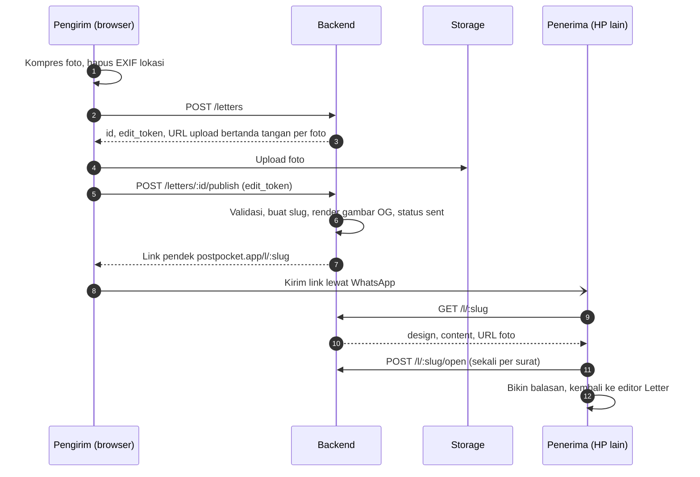

# Panduan Backend PostPocket

Untuk Bintang dan agent-nya. Baca [AGENTS.md](../AGENTS.md) dulu; detail produk lengkap ada di [PRD](prd/PRD-PostPocket.md).

> [!IMPORTANT]
> Rilis 1 cuma butuh server untuk **surat yang dikirim** (modul Letter). Pocket, TV, dan Booth jalan penuh di browser (IndexedDB) dan baru disinkronkan ke server di fase 2.

## Peranmu

Bintang memegang auth, database, storage foto, API surat dan share link, gambar OG untuk preview link, kompresi dan pembersihan file, rate limit, dan deploy backend.

Backend memakai Supabase (Postgres, Auth, Storage, Edge Functions); keputusan ini sudah final dan proyeknya sudah dibuat. Frontend di-deploy ke Vercel Hobby.

Area kode: `supabase/migrations/`, `supabase/functions/`, dan `docs/api/openapi.yaml`.

## Alur surat



## Keputusan yang menunggu

Catat jawabannya di PRD bagian Pertanyaan terbuka (centang dan tulis keputusannya) lewat PR.

| Keputusan | Batas | Catatan |
| --- | --- | --- |
| Bucket `letter-assets` publik atau URL bertanda tangan | Sprint 0 | Path acak tak tertebak per surat tetap wajib |
| Batas ukuran per file dan jumlah foto per surat | Sprint 0 | Frontend sudah mengompres foto ke sisi panjang maksimal 2048 px. Storage gratis Supabase cuma 1 GB, jadi batas ini menentukan berapa surat yang muat |
| Surat berlaku selamanya atau kedaluwarsa | Bareng Kall, Sprint 0 | Menentukan perlu tidaknya job pembersihan file; alasan kuotanya sama seperti baris di atas |

Sudah diputuskan:

- **Supabase**, bukan stack sendiri. Kalau storage 1 GB tidak cukup, foto dipindah ke Cloudflare R2 dan database tetap di Supabase.
- **Gambar OG** dirender sekali di `POST /letters/:id/publish`, disimpan sebagai PNG kecil (di bawah sekitar 300 KB) di storage dan dicatat di `og_path`. Halaman `/l/:slug` di-SSR oleh frontend dan hanya memasang URL-nya.
- **Repo public**, supaya Vercel Hobby mau men-deploy commit dari kita berdua.

## Batasan free tier

| Layanan | Batas yang berpengaruh | Akibatnya |
| --- | --- | --- |
| Supabase Free | Storage 1 GB, 2 proyek aktif | Batas foto dan kedaluwarsa surat diputuskan di Sprint 0. Satu proyek untuk produksi, satu untuk staging |
| Supabase Free | Proyek di-pause setelah 7 hari tanpa request | Selama beta yang sepi, link surat bisa mati; pasang ping terjadwal |
| Vercel Hobby | Body fungsi sekitar 4,5 MB, durasi pendek | Foto selalu diunggah langsung ke storage lewat URL bertanda tangan, tidak lewat fungsi Vercel |
| Vercel Hobby | Hanya untuk non-komersial | Kalau nanti ada monetisasi, pindah ke Pro atau host lain |
| Vercel Hobby | Custom event analitik dan cron terbatas | Event analitik disimpan di tabel Postgres; job pembersihan memakai `pg_cron` |

Draf yang tidak pernah di-publish ikut menghabiskan storage, jadi perlu job `pg_cron` yang menghapus draf beserta fotonya setelah 24 jam.
| Login masuk rilis 1 atau fase 2 | Bareng Kall | PRD menaruh login di fase 2 |

## Checklist per sprint

Centang item di PR yang menyelesaikannya. Agent mulai dari item pertama yang belum dicentang.

**Sprint 0 (minggu 1)**

- [x] Buat repo GitHub (dibuat Kall)
- [x] Buat proyek Supabase, lalu kirim URL dan anon key ke Kall lewat jalur privat, bukan lewat commit
- [ ] Job CI untuk lint dan test backend (workflow `no-ai-attribution` sudah ada)
- [ ] Migrasi `letters` dan `letter_assets`
- [ ] `docs/api/openapi.yaml` untuk lima endpoint rilis 1, supaya Kall bisa jalan dengan mock
- [ ] Putuskan bucket `letter-assets` publik atau bertanda tangan

**Sprint 1 (minggu 2–3)**

- [ ] `POST /letters` dengan URL upload bertanda tangan
- [ ] Rate limit pembuatan surat per IP untuk pengguna anonim
- [ ] Hapus EXIF di sisi server sebagai lapis kedua

**Sprint 2 (minggu 4–5)**

- [ ] `POST /letters/:id/publish`: validasi, slug, render gambar OG, status `sent`
- [ ] `GET /l/:slug` dan `POST /l/:slug/open`
- [ ] `DELETE /letters/:id`
- [ ] `noindex` untuk surat, dikoordinasikan dengan Kall karena halaman `/l/:slug` dirender frontend
- [ ] Gerbang rilis: link surat terbuka di HP lain tanpa login dan preview-nya tampil di WhatsApp

**Sprint 3 (minggu 6–7)**

- [ ] Event analitik: surat dibuat, dibuka, dibalas
- [ ] Monitoring error
- [ ] Review keamanan semua endpoint

**Sprint 4 dan beta (minggu 8–10)**

- [ ] Skema fase 2 (`profiles`, `pockets`, `moments`, `albums`, `album_moments`) beserta RLS
- [ ] Lingkungan beta
- [ ] Selama beta: perbaiki bug, pantau kuota storage dan error

## Data model rilis 1

| Tabel | Kolom penting |
| --- | --- |
| `letters` | `id`, `slug`, `owner_id`, `design` jsonb, `content` jsonb, `cover_path`, `og_path`, `status`, `edit_token_hash`, `reply_to_id`, `opened_at`, `created_at` |
| `letter_assets` | `id`, `letter_id`, `storage_path`, `kind` (`photo`/`sticker`), `width`, `height` |

- `slug` unik, minimal 10 karakter acak, dibuat saat publish.
- `owner_id` boleh kosong selama belum ada login.
- `design` menyimpan **id preset** (gambar depan, bentuk, mode foil, bingkai foil, warna foil, kertas, template), bukan nilai warnanya, supaya preset bisa dipoles tanpa merusak surat lama. Id-nya berasal dari `packages/presets/*.json` milik Kall.
- `content` menyimpan elemen kanvas (teks, foto, stiker) beserta posisi, skala, dan rotasi. Bentuk pastinya disepakati di `openapi.yaml`.
- `edit_token_hash`: server hanya menyimpan hash. Token mentahnya dikembalikan sekali ke browser pengirim, supaya pengirim bisa menghapus suratnya tanpa akun.
- `reply_to_id` menunjuk surat yang dibalas (jalur viral "Bikin balasan").
- `status` bernilai `draft` atau `sent`. `opened_at` diisi sekali saat surat pertama kali dibuka.

Tabel fase 2 (`profiles`, `pockets`, `moments`, `albums`, `album_moments`) ada di PRD bagian Arsitektur. CRUD-nya lewat klien Supabase langsung dengan Row Level Security: user hanya bisa membaca dan menulis barisnya sendiri.

## Endpoint rilis 1

| Method | Path | Fungsi | Auth |
| --- | --- | --- | --- |
| POST | `/letters` | Buat draf, kembalikan `id`, `edit_token`, dan URL upload bertanda tangan untuk tiap foto | Anonim boleh, kena rate limit |
| POST | `/letters/:id/publish` | Validasi isi, buat `slug`, render gambar OG, ubah status jadi `sent` | `edit_token` |
| GET | `/l/:slug` | Ambil surat untuk halaman penerima (design, content, URL foto) | Publik |
| POST | `/l/:slug/open` | Catat waktu pertama kali dibuka | Publik, sekali per surat |
| DELETE | `/letters/:id` | Hapus surat dan fotonya | `edit_token` atau pemilik |

## Storage

- `letter-assets`: path acak tak tertebak per surat. Dibaca lewat URL publik atau bertanda tangan, sesuai keputusan di atas.
- `moments` (fase 2): privat, hanya pemilik.

## Keamanan dan privasi

- Data lokasi EXIF dihapus di browser sebelum upload (Kall) dan di server sebagai lapis kedua (Bintang).
- Slug acak minimal 10 karakter supaya surat tidak bisa ditebak.
- `edit_token` disimpan di browser pengirim; server cuma menyimpan hash-nya.
- Rate limit pembuatan surat per IP untuk pengguna anonim.
- Surat pribadi tidak boleh masuk mesin pencari (`noindex`).
- Secret seperti service role key tidak pernah di-commit.

## Yang dibutuhkan frontend

- `docs/api/openapi.yaml` lebih dulu, supaya Kall bisa membangun UI dengan mock.
- URL proyek dan anon key untuk `.env` (lewat jalur privat).
- CORS untuk domain frontend, termasuk URL preview deploy Vercel yang berubah-ubah (`*.vercel.app` milik proyek kita).
- Gambar OG yang bisa diambil crawler WhatsApp tanpa login, lewat URL yang dikembalikan `GET /l/:slug`.
- Region Supabase di Singapore; fungsi Vercel diset ke `sin1` supaya SSR `/l/:slug` tidak bolak-balik ke US.

## Di luar cakupan rilis 1

Pembayaran, fitur sosial, kolaborasi real-time, sinkron Pocket antar perangkat (fase 2), dan aplikasi native.

## Prompt pembuka untuk agent

```text
Kamu backend engineer PostPocket dan bekerja untuk Bintang. Baca AGENTS.md lalu docs/backend.md.
Aktifkan hook kalau belum: git config core.hooksPath .githooks
Ambil item pertama yang belum dicentang di "Checklist per sprint", kerjakan di branch baru,
buka PR dengan template repo, dan centang item itu di PR yang sama.
Jangan tulis atribusi AI apa pun di commit maupun PR.
```
