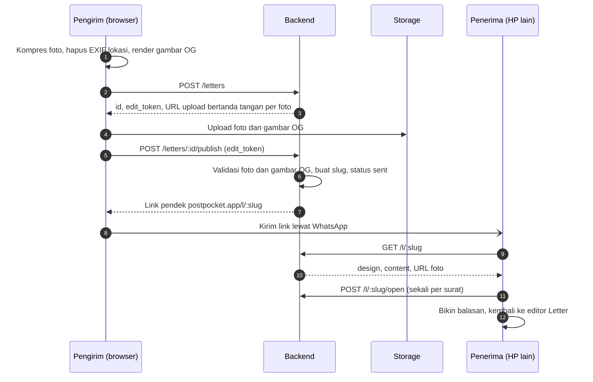

# Panduan Backend PostPocket

Untuk Bintang dan agent-nya. Baca [AGENTS.md](../AGENTS.md) dulu; detail produk lengkap ada di [PRD](prd/PRD-PostPocket.md).

> [!IMPORTANT]
> Rilis 1 cuma butuh server untuk **surat yang dikirim** (modul Letter). Pocket, TV, dan Booth jalan penuh di browser (IndexedDB) dan baru disinkronkan ke server di fase 2.

## Peranmu

Bintang memegang auth, database, storage foto, API surat dan share link, gambar OG untuk preview link, kompresi dan pembersihan file, rate limit, dan deploy backend.

Backend memakai Supabase (Postgres, Auth, Storage, Edge Functions); keputusan ini sudah final dan proyeknya sudah dibuat. Frontend di-deploy ke Vercel Hobby.

Area kode: `supabase/migrations/`, `supabase/functions/`, dan `docs/api/openapi.yaml`.

## Alur surat



## Keputusan yang menunggu

Catat jawabannya di PRD bagian Pertanyaan terbuka (centang dan tulis keputusannya) lewat PR.

| Keputusan | Batas | Catatan |
| --- | --- | --- |
| Login masuk rilis 1 atau fase 2 | Bareng Kall | PRD menaruh login di fase 2 |

## Keputusan yang sudah diambil

| Keputusan | Isi |
| --- | --- |
| Backend | **Supabase**, bukan stack sendiri. Kalau storage 1 GB tidak cukup, foto dipindah ke Cloudflare R2 dan database tetap di Supabase |
| Gambar OG | **Dirender browser** waktu "Buat link" dari kartu yang sama dengan yang dilihat pengirim (JPEG 1200×630, maksimal 300.000 byte; PNG juga diterima tapi dari foto hampir selalu melewati batas), lalu diunggah lewat URL bertanda tangan seperti foto. Backend hanya memvalidasi tipe, ukuran, dan dimensi saat publish, lalu mencatatnya sebagai baris `letter_assets` berjenis `og`. Kalau dirender di Edge Function, tampilan foil harus dibuat ulang di sana |
| Bucket `letter-assets` | **Publik untuk baca**, path acak tak tertebak per surat (`<letter_id>/<uuid>.<ext>`). Upload hanya lewat URL bertanda tangan dari `POST /letters`; tidak ada policy listing. Publik dipilih supaya crawler WhatsApp bisa mengambil gambar OG dan file bisa di-cache CDN (hemat egress) |
| Batas foto | Maksimal **4 foto per surat** (sesuai template kolase), maksimal **500 KB per foto** setelah dikompres, tipe JPEG atau WebP. Cover (gambar depan dari foto user) punya batas yang sama tapi **tidak dihitung** ke 4 foto. Gambar OG maksimal 300 KB |
| Masa berlaku surat | Surat (data, link, dan gambar OG) dihapus **30 hari setelah publish** |
| Masa berlaku foto | Foto dihapus **7 hari setelah surat pertama kali dibuka** (`opened_at`). Kalau tidak pernah dibuka, foto ikut terhapus bersama suratnya di hari ke-30. Kalau gambar depannya foto user, cover dan gambar OG ikut dihapus saat itu karena gambar OG memuat foto yang sama. Setelah dihapus, halaman penerima tetap menampilkan kartu dan teks dengan placeholder, dan memakai gambar OG bawaan |
| Rate limit | `POST /letters` maksimal **10 surat per jam per IP** untuk awal, dievaluasi selama beta. Operator seluler di Indonesia banyak memakai CGNAT, jadi satu IP bisa dipakai banyak orang; kalau 429 mulai sering muncul, kuncinya digabung dengan penanda per perangkat |
| Repo | **Public**. Alasannya, Vercel Hobby memblokir deploy dari commit yang author-nya bukan pemilik akun di repo private. Sudah terbukti di PR #6: commit dari akun Bintang ter-deploy di proyek Vercel milik Kall |

Dengan batas di atas, storage 1 GB muat sekitar 500 surat penuh sekaligus. Karena foto hidup paling lama 7 hari setelah dibuka, yang perlu dipantau adalah jumlah surat aktif, bukan total surat.

## Batasan free tier

| Layanan | Batas yang berpengaruh | Akibatnya |
| --- | --- | --- |
| Supabase Free | Storage 1 GB, 2 proyek aktif | Ditahan oleh batas foto dan masa berlaku di atas. Satu proyek untuk produksi, satu untuk staging |
| Supabase Free | Egress 5 GB per bulan | Foto yang dibuka penerima ikut dihitung dan kemungkinan habis sebelum storage. Dengan 4 foto × 500 KB, cukup untuk sekitar 2.500 kali surat dibuka per bulan; pantau egress selama beta |
| Supabase Free | Proyek di-pause setelah 7 hari tanpa request | Selama beta yang sepi, link surat bisa mati; pasang ping terjadwal |
| Vercel Hobby | Body fungsi sekitar 4,5 MB, durasi pendek | Foto dan gambar OG selalu diunggah langsung ke storage lewat URL bertanda tangan, tidak lewat fungsi Vercel |
| Vercel Hobby | Hanya untuk non-komersial | Kalau nanti ada monetisasi, pindah ke Pro atau host lain |
| Vercel Hobby | Custom event analitik dan cron terbatas | Event analitik disimpan di tabel Postgres; job pembersihan memakai `pg_cron` di Supabase |

## Pembersihan file

Satu job `pg_cron` per jam memanggil Edge Function pembersih lewat `pg_net`. Fungsi itu menghapus:

- draf yang tidak pernah di-publish setelah 24 jam, beserta filenya;
- foto surat yang `opened_at`-nya sudah lewat 7 hari, beserta cover dan gambar OG kalau gambar depannya foto user;
- surat yang sudah lewat 30 hari sejak publish, beserta foto dan gambar OG-nya.

File harus dihapus lewat Storage API (`storage.remove()`) di Edge Function. Menghapus baris `storage.objects` lewat SQL meninggalkan file yatim yang tetap memakan kuota ([Supabase: Delete Objects](https://supabase.com/docs/guides/storage/management/delete-objects)).

## Checklist per sprint

Centang item di PR yang menyelesaikannya. Agent mulai dari item pertama yang belum dicentang.

**Sprint 0 (minggu 1)**

- [x] Buat repo GitHub (dibuat Kall)
- [x] Buat proyek Supabase, lalu kirim URL dan anon key ke Kall lewat jalur privat, bukan lewat commit
- [x] Job CI untuk lint dan test backend: workflow `Backend` (lint skema, test pgTAP, lint `openapi.yaml`)
- [x] Migrasi `letters` dan `letter_assets` beserta RLS dan bucket `letter-assets`
- [x] `docs/api/openapi.yaml` untuk lima endpoint rilis 1, supaya Kall bisa jalan dengan mock
- [x] Putuskan bucket `letter-assets` publik atau bertanda tangan

**Sprint 1 (minggu 2–3)**

- [ ] `POST /letters` dengan URL upload bertanda tangan
- [ ] Rate limit pembuatan surat per IP untuk pengguna anonim
- [ ] Hapus EXIF di sisi server sebagai lapis kedua

**Sprint 2 (minggu 4–5)**

- [ ] `POST /letters/:id/publish`: validasi isi serta foto dan gambar OG yang sudah diunggah, slug, status `sent`
- [ ] Job pembersihan file (`pg_cron` + `pg_net` + Edge Function), lihat bagian Pembersihan file
- [ ] `GET /l/:slug` dan `POST /l/:slug/open`
- [ ] `DELETE /letters/:id`
- [ ] `noindex` untuk surat, dikoordinasikan dengan Kall karena halaman `/l/:slug` dirender frontend
- [ ] Gerbang rilis: link surat terbuka di HP lain tanpa login dan preview-nya tampil di WhatsApp

**Sprint 3 (minggu 6–7)**

- [ ] Event analitik: surat dibuat, dibuka, dibalas
- [ ] Monitoring error
- [ ] Review keamanan semua endpoint

**Sprint 4 dan beta (minggu 8–10)**

- [ ] Skema fase 2 (`profiles`, `pockets`, `moments`, `albums`, `album_moments`) beserta RLS
- [ ] Lingkungan beta
- [ ] Selama beta: perbaiki bug, pantau kuota storage dan error

## Data model rilis 1

| Tabel | Kolom penting |
| --- | --- |
| `letters` | `id`, `slug`, `owner_id`, `design` jsonb, `content` jsonb, `status`, `edit_token_hash`, `reply_to_id`, `created_at`, `draft_expires_at`, `published_at`, `expires_at`, `opened_at`, `photos_expire_at`, `photos_deleted_at` |
| `letter_assets` | `id`, `letter_id`, `storage_path`, `kind` (`photo`/`cover`/`og`), `key` (kunci foto di `content`, khusus `photo`), `mime`, `size`, `width`, `height`, `uploaded_at` |

- `slug` unik, minimal 10 karakter acak, dibuat saat publish.
- `owner_id` boleh kosong selama belum ada login.
- `design` menyimpan **id preset** (gambar depan, bentuk, mode foil, bingkai foil, warna foil, kertas, template), bukan nilai warnanya, supaya preset bisa dipoles tanpa merusak surat lama. Id-nya berasal dari `packages/presets/*.json` milik Kall.
- `content` menyimpan elemen kanvas (teks, foto, stiker) beserta posisi, lebar, dan rotasi. Bentuknya ada di [`docs/api/openapi.yaml`](api/openapi.yaml) (`LetterContent`) dan sama dengan `packages/presets/src/letter-content.ts`.
- `letter_assets` dibuat saat `POST /letters` dari metadata yang dikirim frontend. Stiker tidak diunggah karena berasal dari preset.
- Cover dan gambar OG dicatat sebagai baris `letter_assets` berjenis `cover` dan `og`, bukan kolom di `letters`, supaya semua berkas dibersihkan lewat satu tabel.
- `letter_assets.letter_id` memakai `on delete restrict`: berkas di Storage dihapus lewat Storage API dulu, baru barisnya, lalu suratnya. Urutan lain gagal di database, jadi tidak ada file yatim.
- Batas berkas ditegakkan juga di database: foto dan cover JPEG/WebP ≤ 500.000 byte dan ≤ 2048 px, OG JPEG/PNG 1200×630 ≤ 300.000 byte, maksimal 4 foto per surat, satu cover dan satu OG.
- Kedua tabel memakai RLS tanpa policy dan hak `anon`/`authenticated` dicabut. Semua akses lewat Edge Functions dengan secret key.
- Skema lengkapnya ada di `supabase/migrations/`, ujinya di `supabase/tests/database/`.
- `edit_token_hash`: server hanya menyimpan hash. Token mentahnya dikembalikan sekali ke browser pengirim, supaya pengirim bisa menghapus suratnya tanpa akun.
- `reply_to_id` menunjuk surat yang dibalas (jalur viral "Bikin balasan").
- `status` bernilai `draft` atau `sent`. `opened_at` diisi sekali saat surat pertama kali dibuka.
- `expires_at` = `published_at` + 30 hari. `photos_deleted_at` diisi job pembersihan, supaya `GET /l/:slug` tahu harus menampilkan placeholder foto.

Tabel fase 2 (`profiles`, `pockets`, `moments`, `albums`, `album_moments`) ada di PRD bagian Arsitektur. CRUD-nya lewat klien Supabase langsung dengan Row Level Security: user hanya bisa membaca dan menulis barisnya sendiri.

## Endpoint rilis 1

Detail request, respons, dan kode error ada di [`docs/api/openapi.yaml`](api/openapi.yaml). Semua endpoint dilayani dua Edge Function: `letters` (`/letters/…`) dan `l` (`/l/…`), dengan `verify_jwt` mati karena publishable key bukan JWT. Semua request membawa header `apikey`.

| Method | Path | Fungsi | Auth |
| --- | --- | --- | --- |
| POST | `/letters` | Buat draf, kembalikan `id`, `edit_token`, dan URL upload bertanda tangan untuk tiap foto (maksimal 4) dan gambar OG | Anonim boleh, kena rate limit |
| POST | `/letters/:id/publish` | Validasi isi serta foto dan gambar OG yang sudah diunggah, buat `slug`, ubah status jadi `sent` | Header `X-Edit-Token` |
| GET | `/l/:slug` | Ambil surat untuk halaman penerima (design, content, URL foto) | Publik |
| POST | `/l/:slug/open` | Catat waktu pertama kali dibuka | Publik, sekali per surat |
| DELETE | `/letters/:id` | Hapus surat dan fotonya | Header `X-Edit-Token` (pemilik akun di fase 2) |

## Storage

- `letter-assets`: publik untuk baca, path acak tak tertebak per surat. Upload hanya lewat URL bertanda tangan; tidak ada policy listing.
- `moments` (fase 2): privat, hanya pemilik.

## Keamanan dan privasi

- Data lokasi EXIF dihapus di browser sebelum upload (Kall) dan di server sebagai lapis kedua (Bintang).
- Slug acak minimal 10 karakter supaya surat tidak bisa ditebak.
- `edit_token` disimpan di browser pengirim; server cuma menyimpan hash-nya.
- Rate limit pembuatan surat per IP untuk pengguna anonim.
- Surat pribadi tidak boleh masuk mesin pencari (`noindex`).
- Secret seperti service role key tidak pernah di-commit.

## Yang dibutuhkan frontend

- `docs/api/openapi.yaml` lebih dulu, supaya Kall bisa membangun UI dengan mock.
- URL proyek dan anon key untuk `.env` (lewat jalur privat).
- CORS untuk domain frontend, termasuk URL preview deploy Vercel yang berubah-ubah (`*.vercel.app` milik proyek kita).
- Gambar OG yang dirender browser saat "Buat link" dan bisa diambil crawler WhatsApp tanpa login, lewat URL publik yang dikembalikan `GET /l/:slug`.
- Region Supabase di Singapore; fungsi Vercel diset ke `sin1` supaya SSR `/l/:slug` tidak bolak-balik ke US.

## Di luar cakupan rilis 1

Pembayaran, fitur sosial, kolaborasi real-time, sinkron Pocket antar perangkat (fase 2), dan aplikasi native.

## Prompt pembuka untuk agent

```text
Kamu backend engineer PostPocket dan bekerja untuk Bintang. Baca AGENTS.md lalu docs/backend.md.
Aktifkan hook kalau belum: git config core.hooksPath .githooks
Ambil item pertama yang belum dicentang di "Checklist per sprint", kerjakan di branch baru,
buka PR dengan template repo, dan centang item itu di PR yang sama.
Jangan tulis atribusi AI apa pun di commit maupun PR.
```
