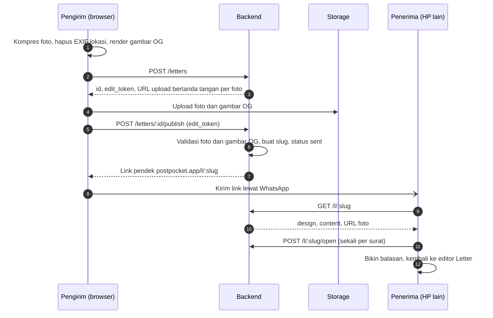

# Panduan Backend PostPocket

Untuk Bintang dan agent-nya. Baca [AGENTS.md](../AGENTS.md) dulu; detail produk lengkap ada di [PRD](prd/PRD-PostPocket.md).

> [!IMPORTANT]
> Rilis 1 cuma butuh server untuk **surat yang dikirim** (modul Letter). Pocket, TV, dan Booth jalan penuh di browser (IndexedDB) dan baru disinkronkan ke server di fase 2.

## Peranmu

Bintang memegang auth, database, storage foto, API surat dan share link, gambar OG untuk preview link, kompresi dan pembersihan file, rate limit, dan deploy backend.

Backend memakai Supabase (Postgres, Auth, Storage, Edge Functions); keputusan ini sudah final dan proyeknya sudah dibuat. Frontend di-deploy ke Vercel Hobby.

Area kode: `supabase/migrations/`, `supabase/functions/`, dan `docs/api/openapi.yaml`.

## Alur surat



## Keputusan yang menunggu

Catat jawabannya di PRD bagian Pertanyaan terbuka (centang dan tulis keputusannya) lewat PR.

Belum ada. Login sudah diputuskan (fase 2, Google OAuth), lihat [Rancangan skema fase 2](#rancangan-skema-fase-2).

## Keputusan yang sudah diambil

| Keputusan | Isi |
| --- | --- |
| Backend | **Supabase**, bukan stack sendiri. Kalau storage 1 GB tidak cukup, foto dipindah ke Cloudflare R2 dan database tetap di Supabase |
| Gambar OG | **Dirender browser** waktu "Buat link" dari kartu yang sama dengan yang dilihat pengirim (JPEG 1200×630, maksimal 300.000 byte; PNG juga diterima tapi dari foto hampir selalu melewati batas), lalu diunggah lewat URL bertanda tangan seperti foto. Backend hanya memvalidasi tipe, ukuran, dan dimensi saat publish, lalu mencatatnya sebagai baris `letter_assets` berjenis `og`. Kalau dirender di Edge Function, tampilan foil harus dibuat ulang di sana |
| Bucket `letter-assets` | **Publik untuk baca**, path acak tak tertebak per surat (`<letter_id>/<uuid>.<ext>`). Upload hanya lewat URL bertanda tangan dari `POST /letters`; tidak ada policy listing. Publik dipilih supaya crawler WhatsApp bisa mengambil gambar OG dan file bisa di-cache CDN (hemat egress) |
| Batas foto | Maksimal **4 foto per surat** (sesuai template kolase), maksimal **500 KB per foto** setelah dikompres, tipe JPEG atau WebP. Cover (gambar depan dari foto user) punya batas yang sama tapi **tidak dihitung** ke 4 foto. Gambar OG maksimal 300 KB |
| Masa berlaku surat | Surat (data, link, dan gambar OG) dihapus **30 hari setelah publish** |
| Masa berlaku foto | Foto dihapus **7 hari setelah surat pertama kali dibuka** (`opened_at`). Kalau tidak pernah dibuka, foto ikut terhapus bersama suratnya di hari ke-30. Kalau gambar depannya foto user, cover dan gambar OG ikut dihapus saat itu karena gambar OG memuat foto yang sama. Setelah dihapus, halaman penerima tetap menampilkan kartu dan teks dengan placeholder, dan memakai gambar OG bawaan |
| Rate limit | `POST /letters` maksimal **10 surat per jam per IP** untuk awal, dievaluasi selama beta. Operator seluler di Indonesia banyak memakai CGNAT, jadi satu IP bisa dipakai banyak orang; kalau 429 mulai sering muncul, kuncinya digabung dengan penanda per perangkat |
| Repo | **Public**. Alasannya, Vercel Hobby memblokir deploy dari commit yang author-nya bukan pemilik akun di repo private. Sudah terbukti di PR #6: commit dari akun Bintang ter-deploy di proyek Vercel milik Kall |

Dengan batas di atas, storage 1 GB muat sekitar 500 surat penuh sekaligus. Karena foto hidup paling lama 7 hari setelah dibuka, yang perlu dipantau adalah jumlah surat aktif, bukan total surat.

## Batasan free tier

| Layanan | Batas yang berpengaruh | Akibatnya |
| --- | --- | --- |
| Supabase Free | Storage 1 GB, 2 proyek aktif | Ditahan oleh batas foto dan masa berlaku di atas. Satu proyek untuk produksi, satu untuk staging |
| Supabase Free | Egress 5 GB per bulan | Foto yang dibuka penerima ikut dihitung dan kemungkinan habis sebelum storage. Dengan 4 foto × 500 KB, cukup untuk sekitar 2.500 kali surat dibuka per bulan; pantau egress selama beta |
| Supabase Free | Proyek di-pause setelah 7 hari tanpa request | Selama beta yang sepi, link surat bisa mati; pasang ping terjadwal |
| Vercel Hobby | Body fungsi sekitar 4,5 MB, durasi pendek | Foto dan gambar OG selalu diunggah langsung ke storage lewat URL bertanda tangan, tidak lewat fungsi Vercel |
| Vercel Hobby | Hanya untuk non-komersial | Kalau nanti ada monetisasi, pindah ke Pro atau host lain |
| Vercel Hobby | Custom event analitik dan cron terbatas | Event analitik disimpan di tabel Postgres ([Analitik](#analitik-dan-monitoring-error)); job pembersihan memakai `pg_cron` di Supabase |

## Pembersihan file

Job `pg_cron` `pembersihan-surat` jalan tiap jam di menit ke-7 dan menjalankan `public.run_cleanup()`. Fungsi SQL itu menghapus baris `rate_limit_hits` yang lebih tua dari 1 jam, lalu memanggil Edge Function `cleanup` lewat `pg_net`. Edge Function itu menghapus:

- draf yang tidak pernah di-publish setelah 24 jam, beserta filenya (diberi tenggang 10 menit supaya publish yang sedang berjalan tidak terpotong);
- foto surat yang `photos_expire_at`-nya sudah lewat (7 hari setelah dibuka), beserta cover dan gambar OG kalau gambar depannya foto user, lalu mengisi `photos_deleted_at`;
- surat yang sudah lewat 30 hari sejak publish, beserta foto dan gambar OG-nya.

Satu putaran memproses paling banyak 1.000 surat per jenis; sisanya diambil putaran berikutnya. `GET /l/:slug` tidak menunggu job: surat jadi 404 begitu `expires_at` lewat, dan foto tidak dikembalikan lagi begitu `photos_expire_at` lewat. Jadi jeda sampai job jalan hanya memengaruhi kuota, tidak pernah terlihat penerima.

Fungsi `cleanup` menerima header `x-cleanup-token` (token acak di Vault, dibuat migrasi `cleanup_job`, tidak pernah ada di repo) atau `Authorization: Bearer <secret key>` untuk test dan pemanggilan manual. `run_cleanup()` membaca URL proyek dari secret Vault `project_url`. Secret ini diisi sekali per lingkungan, dan selama kosong job hanya membersihkan rate limit:

```sh
# Proyek Supabase (sudah diisi untuk produksi)
supabase db query --linked "select vault.create_secret('https://<ref>.supabase.co', 'project_url')"
# Stack lokal: Edge Functions dicapai dari container DB lewat Kong
docker exec supabase_db_postpocket psql -U postgres -c "select vault.create_secret('http://kong:8000', 'project_url')"
```

Hasil panggilan terakhir ada di `net._http_response` (disimpan 6 jam) dan log Edge Function `cleanup`.

File harus dihapus lewat Storage API (`storage.remove()`) di Edge Function. Menghapus baris `storage.objects` lewat SQL meninggalkan file yatim yang tetap memakan kuota ([Supabase: Delete Objects](https://supabase.com/docs/guides/storage/management/delete-objects)).

## Analitik dan monitoring error

Halaman `/privasi` sudah berjanji dua hal: fungsi server tidak mencatat alamat IP, dan tidak ada cookie pelacak atau analitik pihak ketiga. Rancangan di bawah menjaga dua janji itu. Kontrak API dan frontend tidak berubah.

### Event analitik

Tabel `letter_events` hanya berisi tiga kolom:

| Kolom | Isi |
| --- | --- |
| `kind` | `created`, `opened`, atau `replied` |
| `occurred_at` | Waktu kejadian, dibulatkan ke bawah ke jam penuh (UTC) |
| `after_hours` | Jam penuh sejak surat (untuk `replied`: surat yang dibalas) di-publish. Kosong untuk `created` |

Tabel ini tidak menyimpan `letter_id`, slug, IP, user agent, cookie, atau isi surat. Tidak ada kolom yang menunjuk ke surat. Waktunya sengaja dibulatkan ke jam: trigger jalan di transaksi yang sama, jadi `now()` yang presisi akan sama persis dengan `published_at` atau `opened_at` dan bisa di-join 1:1 ke suratnya. Setelah suratnya dihapus di hari ke-30, event tidak bisa dikaitkan lagi, tapi tetap ada. Akibatnya, analitiknya berupa jumlah per periode, bukan alur per surat. Misalnya: berapa surat dibuat minggu ini, berapa persen yang dibuka, dan berapa lama sampai dibuka.

Event dicatat trigger di tabel `letters`, dalam transaksi yang sama dengan perubahannya. Jadi Edge Functions tidak berubah, dan event tidak hilang kalau fungsi gagal di tengah jalan.

| Event | Kapan | Sumber |
| --- | --- | --- |
| `created` | Status draf jadi `sent` | `publish_letter()` |
| `replied` | Sama dengan `created`, untuk surat yang punya `reply_to_id` | `publish_letter()` |
| `opened` | `opened_at` pertama kali terisi | `open_letter()` (idempoten, jadi sekali per surat) |

"Dibuat" dan "dibalas" dihitung saat publish, bukan saat `POST /letters`. Draf yang tidak pernah dikirim terhapus setelah 24 jam dan tidak dihitung. Balasan juga dihitung sebagai surat dibuat.

Baris lebih tua dari 13 bulan dihapus `run_cleanup()`. Datanya dibaca lewat SQL di dashboard, misalnya view `letter_stats_weekly`: jumlah per jenis per minggu (WIB), plus median `after_hours`.

### Monitoring error

Untuk sekarang tidak ada layanan luar (Sentry dan sejenisnya), supaya tidak ada data yang keluar ke pihak ketiga dan `/privasi` tetap benar.

- Setiap respons 5xx dari `letters`, `l`, dan `cleanup` dicatat ke tabel `function_errors`, dengan kolom:
  - `function`, `route` (pola, misalnya `/l/:slug`, bukan path aslinya);
  - `status`, `error_name` (misalnya `TypeError`, `PostgrestError`), `error_code` (kode PostgREST atau Postgres seperti `PGRST116` atau `57014`, atau status Storage);
  - `occurred_at`.

  Pesan error tidak disimpan. Error `fetch` di Deno menyertakan URL lengkap, termasuk filter PostgREST seperti `slug=eq.…`, dan error Postgres kadang menyertakan nilai input. Nama dan kode disaring dengan pola huruf, angka, dan garis bawah di fungsi dan sekali lagi di constraint tabel. Header, body, IP, slug, dan token tidak dicatat. Barisnya disimpan 30 hari, lalu dihapus `run_cleanup()`.
- Pencatatannya best effort lewat `EdgeRuntime.waitUntil()`. Respons 500 keluar tanpa menunggu insert, dan kalau insert-nya gagal (biasanya justru saat DB bermasalah), cukup ditulis ke log.
- Log Edge Function di dashboard Supabase tetap jadi tempat detail. Log itu dicatat penyedia, sesuai kalimat log teknis di `/privasi`.
- Hasil panggilan job pembersihan dicek dari `net._http_response`.
- View `function_errors_daily` merangkum error per fungsi, route, dan kode per hari (WIB). Selama beta, view ini dicek tiap hari bareng pemantauan kuota storage dan egress.
- 5xx dari gateway atau platform tidak lewat kode fungsi, jadi tidak masuk `function_errors`. Contohnya boot error, `WORKER_LIMIT`, dan timeout. Pengecekan harian tetap melihat Logs dan Invocations tiap fungsi di dashboard.

Error di browser (frontend) belum tercakup. Kalau nanti perlu, butuh endpoint baru, yang masuk kontrak dulu.

### Akses

Relasi baru di schema `public` otomatis dapat grant ke `anon` dan `authenticated`. View yang dibuat `postgres` juga jalan dengan hak pemiliknya, jadi RLS tabel di bawahnya dilewati. Karena itu:

- `letter_events` dan `function_errors` memakai RLS tanpa policy, dan hak `anon`/`authenticated` dicabut;
- `letter_stats_weekly` dan `function_errors_daily` dibuat `with (security_invoker = true)`, dan hak `anon`/`authenticated` juga dicabut;
- pgTAP memastikan `anon` dan `authenticated` tidak bisa `select` dari keempatnya.

Yang bisa membaca hanya secret key dan SQL di dashboard (SQL Editor), atau CLI yang di-link:

```sh
supabase db query --linked "select * from letter_stats_weekly order by week desc, kind"
supabase db query --linked "select * from function_errors_daily where day > current_date - 7 order by day desc"
```

## Checklist per sprint

Centang item di PR yang menyelesaikannya. Agent mulai dari item pertama yang belum dicentang.

**Sprint 0 (minggu 1)**

- [x] Buat repo GitHub (dibuat Kall)
- [x] Buat proyek Supabase, lalu kirim URL dan anon key ke Kall lewat jalur privat, bukan lewat commit
- [x] Job CI untuk lint dan test backend: workflow `Backend` (lint skema, test pgTAP, lint `openapi.yaml`)
- [x] Migrasi `letters` dan `letter_assets` beserta RLS dan bucket `letter-assets`
- [x] `docs/api/openapi.yaml` untuk lima endpoint rilis 1, supaya Kall bisa jalan dengan mock
- [x] Putuskan bucket `letter-assets` publik atau bertanda tangan

**Sprint 1 (minggu 2–3)**

- [x] `POST /letters` dengan URL upload bertanda tangan
- [x] Rate limit pembuatan surat per IP untuk pengguna anonim
- [x] Hapus EXIF di sisi server sebagai lapis kedua (saat publish, lihat bagian Edge Functions)

**Sprint 2 (minggu 4–5)**

- [x] `POST /letters/:id/publish`: validasi isi serta foto dan gambar OG yang sudah diunggah, slug, status `sent`
- [x] Job pembersihan file (`pg_cron` + `pg_net` + Edge Function), lihat bagian Pembersihan file
- [x] `GET /l/:slug` dan `POST /l/:slug/open`
- [x] `DELETE /letters/:id`
- [x] `noindex` untuk surat: halaman `/l/:slug` memakai `robots: noindex` (Kall), respons API memakai `Cache-Control: no-store`
- [x] Gerbang rilis: link surat terbuka di HP lain tanpa login dan preview-nya tampil di WhatsApp, lolos 13 Oktober 2026 (hasil cek di [frontend.md](frontend.md#gerbang-sprint-2))

**Sprint 3 (minggu 6–7)**

- [x] Event analitik: surat dibuat, dibuka, dibalas ([Analitik](#analitik-dan-monitoring-error))
- [x] Monitoring error tanpa layanan luar (`function_errors`, plus log dashboard untuk error gateway)
- [x] Review keamanan semua endpoint ([hasil](#review-keamanan))

**Sprint 4 dan beta (minggu 8–10)**

- [x] Skema fase 2 (`profiles`, `pockets`, `moments`, `albums`) beserta RLS: [Rancangan skema fase 2](#rancangan-skema-fase-2), migrasi `phase2` dan test `phase2.test.sql`
- [ ] Lingkungan beta
- [ ] Selama beta: perbaiki bug, pantau kuota storage dan error

## Data model rilis 1

| Tabel | Kolom penting |
| --- | --- |
| `letters` | `id`, `slug`, `owner_id`, `design` jsonb, `content` jsonb, `status`, `edit_token_hash`, `reply_to_id`, `created_at`, `draft_expires_at`, `published_at`, `expires_at`, `opened_at`, `photos_expire_at`, `photos_deleted_at` |
| `letter_assets` | `id`, `letter_id`, `storage_path`, `kind` (`photo`/`cover`/`og`), `key` (kunci foto di `content`, khusus `photo`), `mime`, `size`, `width`, `height`, `uploaded_at` |
| `rate_limit_hits` | `bucket`, `key` (HMAC dari IP, bukan IP mentah), `created_at`. Diisi `take_rate_limit()` |
| `letter_events` | `kind` (`created`/`opened`/`replied`), `occurred_at` (dibulatkan ke jam), `after_hours`. Diisi trigger `letters_record_event` |
| `function_errors` | `function`, `route` (pola), `status`, `error_name`, `error_code`, `occurred_at`. Diisi Edge Functions lewat `_shared/errors.ts` |

- `slug` unik, minimal 10 karakter acak, dibuat saat publish.
- `owner_id` boleh kosong selama belum ada login.
- `design` menyimpan **id preset** (gambar depan, bentuk, mode foil, bingkai foil, warna foil, kertas, template), bukan nilai warnanya, supaya preset bisa dipoles tanpa merusak surat lama. Id-nya berasal dari `packages/presets/*.json` milik Kall.
- `content` menyimpan elemen kanvas (teks, foto, stiker) beserta posisi, lebar, dan rotasi. Bentuknya ada di [`docs/api/openapi.yaml`](api/openapi.yaml) (`LetterContent`) dan sama dengan `packages/presets/src/letter-content.ts`.
- `letter_assets` dibuat saat `POST /letters` dari metadata yang dikirim frontend. Stiker tidak diunggah karena berasal dari preset.
- Cover dan gambar OG dicatat sebagai baris `letter_assets` berjenis `cover` dan `og`, bukan kolom di `letters`, supaya semua berkas dibersihkan lewat satu tabel.
- `letter_assets.letter_id` memakai `on delete restrict`: berkas di Storage dihapus lewat Storage API dulu, baru barisnya, lalu suratnya. Urutan lain gagal di database, jadi tidak ada file yatim.
- Batas berkas ditegakkan juga di database: foto dan cover JPEG/WebP ≤ 500.000 byte dan ≤ 2048 px, OG JPEG/PNG 1200×630 ≤ 300.000 byte, maksimal 4 foto per surat, satu cover dan satu OG.
- Kedua tabel memakai RLS tanpa policy dan hak `anon`/`authenticated` dicabut. Semua akses lewat Edge Functions dengan secret key. Tabel fase 2 (`profiles`, `moments`, `pockets`, `albums`) beda: dibuka untuk `authenticated` dengan RLS per user, lihat [Rancangan skema fase 2](#rancangan-skema-fase-2).
- Skema lengkapnya ada di `supabase/migrations/`, ujinya di `supabase/tests/database/`.
- Fungsi database untuk Edge Functions: `create_letter()` (draf dan baris berkas dalam satu transaksi), `publish_letter()`, `open_letter()` (idempoten), `take_rate_limit()`, serta `cleanup_token_valid()` dan `run_cleanup()` untuk job pembersihan. Trigger `record_letter_event()` mengisi `letter_events`. Semuanya hanya bisa dijalankan secret key.
- `edit_token_hash`: server hanya menyimpan hash. Token mentahnya dikembalikan sekali ke browser pengirim, supaya pengirim bisa menghapus suratnya tanpa akun.
- `reply_to_id` menunjuk surat yang dibalas (jalur viral "Bikin balasan").
- `status` bernilai `draft` atau `sent`. `opened_at` diisi sekali saat surat pertama kali dibuka.
- `expires_at` = `published_at` + 30 hari. `photos_deleted_at` diisi job pembersihan, supaya `GET /l/:slug` tahu harus menampilkan placeholder foto.

## Rancangan skema fase 2

Disetujui Kall di #47. Migrasinya `supabase/migrations/20261014053904_phase2.sql`, ujinya `supabase/tests/database/phase2.test.sql`. Sumbernya tabel fase 2 di PRD bagian Arsitektur, disesuaikan dengan data Pocket yang sudah jalan di browser (`apps/web/app/utils/memories.ts`), supaya sinkron nanti cuma memindahkan baris, bukan mengubah bentuk data.

**Prinsip**

- IndexedDB tetap sumber utama dan tetap jalan offline. Server adalah cadangan dan jalur sinkron antar perangkat, aktif hanya setelah login (Google OAuth).
- CRUD lewat klien Supabase langsung (`supabase-js` dengan sesi user), tanpa Edge Function. RLS di setiap tabel: user hanya bisa membaca dan menulis baris dengan `owner_id = auth.uid()`.
- Id momen dan album dibuat di browser (`crypto.randomUUID()`), supaya bisa dibuat offline dan dikirim ulang dengan `upsert` tanpa jadi ganda. Kantong tidak punya id: kuncinya `(owner_id, day)`, sama seperti `PocketDay` yang dikunci per hari, jadi dua HP yang membuat kantong hari yang sama secara offline langsung bertemu di satu baris.
- Hapus di satu perangkat harus sampai ke perangkat lain, jadi baris tidak langsung dihapus: `deleted_at` diisi. Baris berstatus hapus dibuang job pembersihan setelah 30 hari.
- `updated_at` diisi trigger server, bukan browser, supaya jam HP yang salah tidak merusak urutan sinkron. Konflik diselesaikan "tulisan terakhir menang" per baris.

**Tabel**

| Tabel | Kolom | Beda dari PRD |
| --- | --- | --- |
| `profiles` | `id` (= `auth.users.id`), `display_name` (≤ 40 karakter), `created_at` | Dibuat trigger saat user mendaftar |
| `moments` | `id`, `owner_id`, `day` (date), `taken_at`, `source` (`upload`/`booth`), `width`, `height`, `mime`, `size`, `created_at`, `updated_at`, `deleted_at` | `day` menggantikan `pocket_id`, sama seperti `Moment.day` di browser: momen bisa ada sebelum kantongnya disimpan. `storage_path` tidak disimpan karena selalu `<owner_id>/<id>.<ext>` |
| `pockets` | `owner_id` + `day` (primary key), `packet`, `sticker`, `frame`, `frame_color`, `moment_ids` (uuid[], urutan di kantong, maksimal 500), `saved_at`, `updated_at`, `deleted_at` | Tanpa `id`. Nama kolom mengikuti `PocketDay`. Urutan momen disimpan sebagai array |
| `albums` | `id`, `owner_id`, `title` (≤ 40), `emoji`, `color`, `moment_ids` (uuid[], urutan di CD, maksimal 500), `created_at`, `updated_at`, `deleted_at` | Hanya album buatan user. Album per bulan dihitung browser dari `moments.day`, jadi `kind` dan `month` tidak perlu. `album_moments` diganti `moment_ids` |

- `packet`, `sticker`, `frame`, dan `frame_color` menyimpan id preset (atau `#rrggbb` untuk warna custom), sama seperti `design` di `letters`. Database hanya mengecek bentuknya (huruf, angka, `-`, maksimal 40 karakter), bukan isi daftar preset.
- `moment_ids` sebagai array, bukan tabel `album_moments`, karena satu kantong atau album selalu ditulis utuh, sehingga sinkronnya satu baris. Id momen milik user lain di array tidak berbahaya: RLS tetap menyembunyikan momennya. Kalau nanti butuh query "momen ini ada di album mana", baru dipecah jadi tabel.
- `owner_id` punya `default auth.uid()` dan `references auth.users on delete cascade`, jadi hapus akun menghapus semua barisnya. Berkas di Storage tetap harus dihapus dulu lewat Storage API (lihat `letter_assets`), jadi hapus akun lewat Edge Function, bukan langsung dari browser.
- Hak `anon` dicabut dari semua tabel ini. `authenticated` hanya dapat `select`, `insert`, dan `update`, tanpa `delete`: hapus dari browser selalu lewat `deleted_at`.

**Kuota**

- Selama beta, maksimal **100 momen aktif per user** (sekitar 50 MB). Trigger di `moments` menolak insert, atau update yang mengosongkan `deleted_at`, kalau user sudah punya 100 momen dengan `deleted_at is null`.
- Kuota ini hanya berarti kalau setiap berkas punya baris. Karena itu policy unggah di bucket `moments` mensyaratkan baris `moments` milik user dengan `id` sama dengan nama berkas dan `deleted_at is null` (dicatat Kall). Satu baris, satu berkas: tanpa policy update, berkasnya juga tidak bisa ditimpa.
- Momen yang dihapus berkasnya dihapus browser saat itu juga (policy hapus), dan job pembersihan harian menghapus berkas yang masih tertinggal untuk baris dengan `deleted_at`. Jadi hapus lalu tambah lagi hanya bisa menumpuk berkas paling lama sehari. Bagian job ini (dan membuang baris berstatus hapus setelah 30 hari) belum dibuat; menyusul sebelum sinkron dipakai.
- Storage menjawab `400` (bukan `403`) kalau unggah ditolak policy, dengan pesan `new row violates row-level security policy`.

**Sinkron (bagian frontend, dicatat di sini supaya skemanya tidak salah dipakai)**

- Tarik perubahan pakai jendela tumpang tindih: `updated_at > sinkron_terakhir - 5 menit`. `updated_at = now()` adalah waktu mulai transaksi, jadi transaksi yang commit belakangan bisa punya `updated_at` lebih kecil dari titik sinkron terakhir. Penerapan di browser harus idempoten, karena baris yang sama bisa datang dua kali.
- "Tulisan terakhir menang" per baris berarti HP yang lama offline bisa menimpa urutan `moment_ids` yang lebih baru. Di kantong, browser menempelkan lagi momen dengan `day` itu yang tidak ada di array, jadi foto tidak hilang dari kantong. Di album CD, tambahan dari HP lain bisa hilang. Diterima untuk beta.
- Sinkron pertama mengganti id lokal momen (`m` + 6 karakter) dan album (`a` + 6 karakter) dengan UUID, termasuk di `PocketDay.moments`, `Album.moments`, dan kunci foto di IndexedDB.
- Yang naik ke bucket adalah versi kompres ≤ 500 KB, sama seperti foto surat. Foto lokal (JPEG 2048 px, kualitas 0,86) sering lebih besar, jadi HP lain mendapat versi kompresnya.

**Storage**

- Bucket `moments`: privat, 500 KB per berkas, JPEG atau WebP, path `<owner_id>/<moment_id>.<ext>`.
- Policy untuk `authenticated`: baca dan hapus kalau folder pertamanya `auth.uid()`; unggah kalau folder pertamanya `auth.uid()` dan ada baris `moments` yang cocok (lihat Kuota). Tidak ada policy update dan tidak ada policy untuk `anon`.
- Foto ditampilkan lewat signed URL berumur pendek (`createSignedUrls`, satu panggilan per banyak foto).
- `security.test.sql` disesuaikan: policy storage untuk `authenticated` hanya boleh ada di bucket `moments` dan wajib memeriksa `auth.uid()`. Untuk `anon` dan `public` tetap tidak boleh ada. Test RLS baru wajib mencoba unggah tanpa baris `moments`, ke folder user lain, dan melewati 100 momen.

**Keputusan (diambil bareng Kall, 14 Oktober 2026)**

1. **Login: Google OAuth dulu.** Tidak perlu mengirim email. Magic link menyusul kalau ada yang minta, dengan SMTP sendiri, karena SMTP bawaan Supabase hanya mengirim beberapa email per jam dan hanya ke anggota tim proyek.
2. **Kuota: 100 momen per user selama beta.** Sebelum dibuka untuk umum, bandingkan Supabase Pro dengan Cloudflare R2. R2 lebih murah, tapi berada di luar RLS Supabase, jadi butuh Edge Function untuk signed URL unggah dan baca.
3. **Masuk produksi begitu merge.** Tabelnya terkunci RLS dan belum dipakai, dan `main` tetap sama dengan produksi. Kalau ditahan, `supabase db push` untuk hotfix surat berikutnya ikut menerapkan migrasi fase 2 juga.

## Endpoint rilis 1

Detail request, respons, dan kode error ada di [`docs/api/openapi.yaml`](api/openapi.yaml). Semua endpoint dilayani dua Edge Function: `letters` (`/letters/…`) dan `l` (`/l/…`), dengan `verify_jwt` mati karena publishable key bukan JWT. Semua request membawa header `apikey`.

| Method | Path | Fungsi | Auth |
| --- | --- | --- | --- |
| POST | `/letters` | Buat draf, kembalikan `id`, `edit_token`, dan URL upload bertanda tangan untuk tiap foto (maksimal 4) dan gambar OG | Anonim boleh, kena rate limit |
| POST | `/letters/:id/publish` | Validasi isi serta foto dan gambar OG yang sudah diunggah, buat `slug`, ubah status jadi `sent` | Header `X-Edit-Token` |
| GET | `/l/:slug` | Ambil surat untuk halaman penerima (design, content, URL foto) | Publik |
| POST | `/l/:slug/open` | Catat waktu pertama kali dibuka | Publik, sekali per surat |
| DELETE | `/letters/:id` | Hapus surat dan fotonya | Header `X-Edit-Token` (pemilik akun di fase 2) |

## Edge Functions

Tiga fungsi di `supabase/functions/`, semuanya dengan `verify_jwt = false`:

| Fungsi | Endpoint |
| --- | --- |
| `letters` | `POST /letters`, `POST /letters/{id}/publish`, `DELETE /letters/{id}` |
| `l` | `GET /l/{slug}`, `POST /l/{slug}/open` |
| `cleanup` | Job pembersihan, bukan bagian kontrak (lihat bagian Pembersihan file) |

Kode bersama ada di `_shared/`:

- `http.ts`: CORS sesuai kontrak, cek header `apikey` (harus publishable key proyek), dan bentuk error.
- `validate.ts`: body `POST /letters` dicek dengan skema dari kontrak (`_shared/openapi.json`, hasil `scripts/bundle-contract.sh`), lalu aturan isi dicek dengan preset dan `contentLimits` dari `packages/presets`, sama seperti mock frontend.
- `image.ts`: membaca tipe dan dimensi dari isi berkas, lalu membuang EXIF, XMP, IPTC, dan komentar tanpa kompres ulang.
- `files.ts`: hapus berkas lewat Storage API dulu, baru barisnya. Dipakai `DELETE /letters/{id}` dan job pembersihan.
- `errors.ts`: mencatat error 5xx ke `function_errors` (pola route, nama, dan kode saja), best effort lewat `EdgeRuntime.waitUntil()`.
- `db.ts`: klien secret key. Secret key diambil dari env yang disediakan Supabase (`SUPABASE_SECRET_KEYS`), jadi tidak perlu `secrets set`.

Yang terjadi saat publish: setiap berkas diunduh dari Storage, ukurannya harus sama persis dengan metadata, tipe dan dimensinya dibaca dari isi berkas (bukan dari header). Kalau ada metadata yang tersisa atau content-type dari browser salah, berkasnya ditulis ulang tanpa metadata. Baru setelah itu `slug` dibuat dan status jadi `sent`.

Rate limit memakai IP dari `cf-connecting-ip`. Di proyek Supabase request lewat Cloudflare, yang mengisi header itu dengan IP asli dan menolak request yang mengirimnya sendiri; `x-forwarded-for` dari klien juga ditimpa (dicek langsung di proyek, Oktober 2026). IPv6 dihitung per /64.

```sh
# Stack lokal lengkap (DB, Storage, Edge Functions)
supabase start -x studio,imgproxy,mailpit,realtime,logflare,vector,supavisor,postgres-meta

# Dari supabase/functions
deno test tests/unit.test.ts
API_URL=http://127.0.0.1:54321 PUBLISHABLE_KEY=<dari supabase status> deno test -A tests/api.test.ts
# Job pembersihan, hanya stack lokal (memundurkan waktu di database)
API_URL=… PUBLISHABLE_KEY=… SECRET_KEY=<dari supabase status> deno test -A tests/cleanup.test.ts

# Setelah kontrak berubah
scripts/bundle-contract.sh

# Deploy (setelah migrasi baru di-push dengan supabase db push)
supabase functions deploy letters l cleanup
```

Di stack lokal, Kong menimpa header CORS dengan `*`, jadi test CORS di `api.test.ts` hanya jalan kalau `API_URL` menunjuk proyek Supabase asli.

## Storage

- `letter-assets`: publik untuk baca, path acak tak tertebak per surat. Upload hanya lewat URL bertanda tangan; tidak ada policy listing.
- `moments` (fase 2): privat, hanya pemilik.

## Keamanan dan privasi

- Data lokasi EXIF dihapus di browser sebelum upload (Kall) dan di server sebagai lapis kedua (Bintang).
- Slug acak minimal 10 karakter supaya surat tidak bisa ditebak.
- `edit_token` disimpan di browser pengirim; server cuma menyimpan hash-nya.
- Rate limit pembuatan surat per IP untuk pengguna anonim.
- Surat pribadi tidak boleh masuk mesin pencari (`noindex`).
- Secret seperti service role key tidak pernah di-commit.

### Review keamanan

Review semua endpoint dan akses langsung ke Supabase, Oktober 2026 (Sprint 3). Diuji ke produksi dengan publishable key, kecuali yang ditandai lokal.

| Yang dicek | Hasil |
| --- | --- |
| REST `/rest/v1` ke `letters`, `letter_assets`, `rate_limit_hits`, `letter_events`, `function_errors`, dan kedua view | Ditolak `42501`. Insert juga ditolak (dicek Kall) |
| RPC ke semua fungsi di `public` (`create_letter`, `publish_letter`, `open_letter`, `take_rate_limit`, `run_cleanup`, `cleanup_token_valid`) | Ditolak `42501`. Tidak ada fungsi di `public` yang bisa dijalankan `anon` atau `authenticated` |
| GraphQL `/graphql/v1` | `pg_graphql` tidak aktif |
| Storage `letter-assets` | Listing kosong, termasuk untuk folder yang ada isinya (dicek Kall). Upload langsung ditolak RLS. Bucket membatasi 500 KB dan hanya JPEG/WebP/PNG |
| Menimpa berkas lewat `signedUrl` setelah publish (lokal) | Ditolak `409 KeyAlreadyExists`, juga dengan `x-upsert: true`, karena URL-nya dibuat tanpa upsert. Jadi berkas yang sudah dicek dan dibersihkan saat publish tidak bisa diganti |
| `X-Edit-Token` | 32 byte acak, server hanya menyimpan SHA-256-nya dan membandingkan tanpa bocor lewat waktu |
| Slug | 10 karakter base62 acak (sekitar 8 × 10¹⁷ kemungkinan), jadi tidak bisa ditebak walau `GET /l/:slug` tanpa rate limit |
| Fungsi `cleanup` | Tanpa token, dengan token salah, atau dengan publishable key: `401` |

Yang diperbaiki di review ini:

- CORS tidak lagi menerima `http://localhost:3000` di produksi (kontrak 0.2.3). Stack lokal tidak terpengaruh, karena gateway-nya menjawab `*`.
- CORS juga tidak lagi menerima preview Vercel (dicatat Kall). Nama `<proyek>.vercel.app` bisa didaftarkan siapa saja, jadi proyek bernama `postpocket-x-haikalfaruqs-projects` cocok dengan pola preview dan halamannya bisa memakai browser pengunjung untuk membuat surat dari banyak IP. Preview cukup memakai mock API.
- Body `POST /letters` dibaca bertahap dan dihentikan begitu lewat 100 KB, juga kalau `Content-Length` sudah lewat batas. Sebelumnya body dibaca utuh ke memori dulu, baru dicek.
- Semua respons JSON membawa `X-Content-Type-Options: nosniff`.
- Test pgTAP `security.test.sql` menjaga semua aturan akses di atas. Migrasi baru yang lupa `revoke`, lupa RLS, atau membuat view tanpa `security_invoker` akan gagal di CI. Sejak fase 2, test ini juga mendaftar persis hak `authenticated` (select, insert, update di tabel fase 2, tanpa delete) dan hanya menerima policy storage untuk `authenticated` di bucket `moments` yang memeriksa `auth.uid()`.

Risiko yang diterima untuk rilis 1:

- `POST /letters/:id/publish` dan `DELETE` tidak dibatasi rate limit. Keduanya butuh edit token milik draf sendiri, dan pembuatan draf sudah dibatasi 10 per jam per IP. Publish yang gagal berulang tetap mengunduh berkasnya lagi (paling banyak 6 × 500 KB). Kalau terlihat di `function_errors` atau egress, tambahkan rate limit per surat.
- `GET /l/:slug` dan `open` tidak dibatasi. Slug tidak bisa ditebak, dan `open` idempoten.
- Rate limit per IP lemah di CGNAT (lihat Keputusan yang sudah diambil).
- Berkas di bucket publik bisa dibuka siapa pun yang tahu URL lengkapnya. Itu memang dibutuhkan crawler WhatsApp, dan path-nya memuat dua UUID acak.

## Yang dibutuhkan frontend

- `docs/api/openapi.yaml` lebih dulu, supaya Kall bisa membangun UI dengan mock.
- URL proyek dan anon key untuk `.env` (lewat jalur privat).
- CORS untuk domain frontend produksi saja. Preview deploy Vercel dan `pnpm dev` memakai mock API atau stack lokal (kontrak 0.2.3).
- Gambar OG yang dirender browser saat "Buat link" dan bisa diambil crawler WhatsApp tanpa login, lewat URL publik yang dikembalikan `GET /l/:slug`.
- Proyek Supabase (DB dan Storage) ada di Sydney (`ap-southeast-2`). Edge Functions secara bawaan jalan di region terdekat dengan pemanggil, yaitu Singapura (`ap-southeast-1`) untuk pengguna di Indonesia dan fungsi Vercel `sin1`, lalu setiap query bolak-balik ke Sydney. Karena itu frontend memanggil fungsi dengan `?forceFunctionRegion=ap-southeast-2` (kontrak 0.2.2): `GET /l/:slug` turun dari median sekitar 1,0 detik ke 0,55 detik (diukur Kall dan Bintang, Oktober 2026). Region yang dipaksa tidak dialihkan kalau Sydney down, tapi DB-nya juga di sana.
- Fungsi Vercel diset ke `sin1` supaya SSR `/l/:slug` tidak bolak-balik ke US.

## Di luar cakupan rilis 1

Pembayaran, fitur sosial, kolaborasi real-time, sinkron Pocket antar perangkat (fase 2), dan aplikasi native.

## Prompt pembuka untuk agent

```text
Kamu backend engineer PostPocket dan bekerja untuk Bintang. Baca AGENTS.md lalu docs/backend.md.
Aktifkan hook kalau belum: git config core.hooksPath .githooks
Ambil item pertama yang belum dicentang di "Checklist per sprint", kerjakan di branch baru,
buka PR dengan template repo, dan centang item itu di PR yang sama.
Jangan tulis atribusi AI apa pun di commit maupun PR.
```
