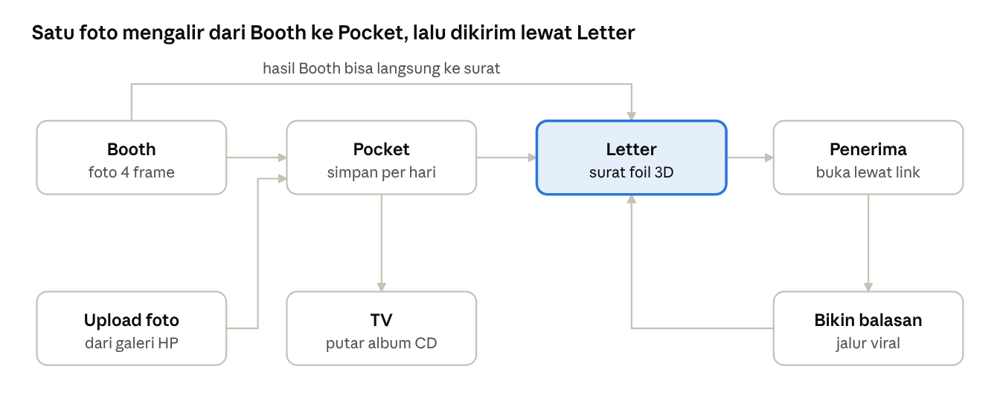
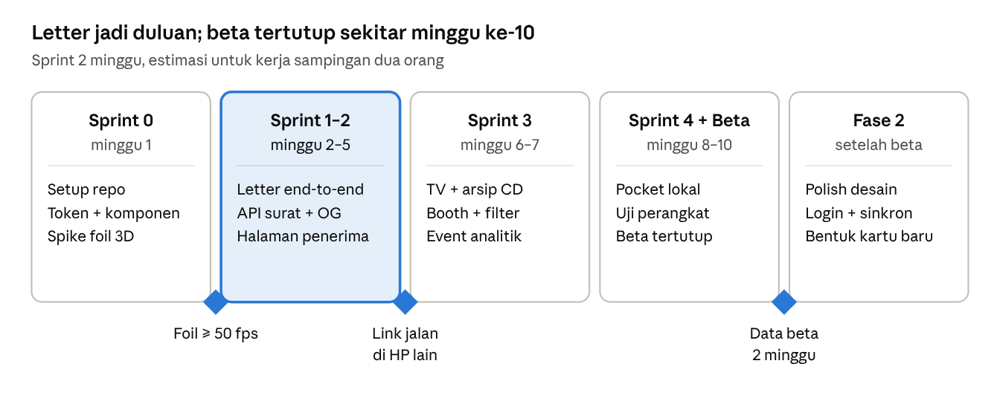

# PRD — PostPocket

Oct 10, 2026 · @Kall

## Ringkasan

PostPocket adalah satu web untuk menangkap momen (Booth), menyimpannya per hari (Pocket), lalu mengirimkannya ke orang lain sebagai surat foil 3D (Letter). Rilis pertama meniru layout dan interaksi tiga referensi sedekat mungkin, lalu dipoles setelah produk jalan.

**Masalah.** Foto menumpuk di galeri tanpa cerita, dan kirim foto lewat chat terasa datar. Tiga referensi membuktikan orang suka wadah digital yang terasa seperti benda fisik: kartu foil, kantong snack, TV jadul.

**Referensi utama**

| Modul | Referensi | Yang ditiru |
| --- | --- | --- |
| Letter | [Foil Studio](https://www.bubbbly.com/foil-studio) | Kartu foil 3D, panel opsi bertahap 1 sampai 5, Surprise me, kirim lewat link |
| Pocket | [Day Pocket](https://daypocket.replit.app/) | Kalender bulanan, modal "tuck in a little day", kantong + stiker + bingkai foto |
| TV & Booth | [Memory TV](https://memorytv.replit.app/) | TV clay jadul, filter foto, arsip CD coverflow, tombol Photo Booth |

**Tujuan rilis 1 (MVP)**

- User bisa membuat dan mengirim surat foil lewat link tanpa login.
- Penerima bisa membuka surat di HP dengan animasi buka kartu yang mulus.
- User bisa menyimpan foto ke kantong harian dan memutarnya di TV.
- User bisa memotret lewat Booth dan langsung memakai hasilnya di surat.

**Bukan target rilis 1:** aplikasi native, editor ilustrasi sendiri, pembayaran, fitur sosial (follow, feed, like), kolaborasi real-time.

**Metrik sukses (8 minggu setelah rilis)**

- Persentase surat yang link-nya benar-benar dibuka penerima.
- Persentase penerima yang lanjut membuat surat balasan (jalur viral).
- Jumlah hari terisi per user aktif di Pocket per bulan.

Angka target belum ditetapkan; ditentukan Kall dan Bintang setelah 2 minggu data beta.

## Tim dan peran

Tim berisi dua engineer tanpa desainer UI/UX, 3D, atau ilustrator, jadi aturan kerjanya: tiru dulu, poles nanti.

| Orang | Peran | Tanggung jawab utama |
| --- | --- | --- |
| Kall | Frontend | Semua halaman dan interaksi, kartu foil 3D, editor surat, kalender Pocket, TV dan Booth, penyimpanan lokal (IndexedDB), integrasi API, deploy frontend |
| Bintang | Backend | Auth, database, storage foto, API surat dan share link, gambar OG untuk preview link, kompresi dan pembersihan file, rate limit, deploy backend |

**Prinsip "tiru dulu, poles nanti"**

1. Layout, urutan langkah, jarak, dan interaksi dibuat semirip mungkin dengan referensi. Ukuran dan catatan referensi ada di `docs/reference/`; screenshot-nya disimpan di folder bersama di luar repo karena repo public.
2. Aset visual (kantong snack, stiker, ilustrasi kartu, bentuk TV) tidak diambil dari web referensi. Pakai aset berlisensi bebas atau buatan sendiri (lihat bagian Design system dan aset).
3. Semua warna, radius, font, dan bayangan disimpan sebagai design token, supaya fase polish cukup mengganti token tanpa membongkar komponen.
4. Setiap pilihan desain (kertas, foil, kantong, stiker, bingkai, filter) adalah data preset JSON, bukan hardcode di komponen. Desainer bisa menambah preset nanti tanpa kode baru.

**Cara kerja bareng**

- Kontrak API ditulis dulu (OpenAPI di repo) sebelum Kall menyambungkan UI, supaya FE bisa jalan dengan mock.
- Satu repo monorepo, branch per fitur, PR wajib di-review satu orang lainnya.
- Sinkron singkat dua kali seminggu; keputusan dicatat di bagian Pertanyaan terbuka dokumen ini.

## Konsep produk

PostPocket diposisikan sebagai kantong pribadi berisi tiga benda: kamera booth, kantong harian, dan kartu surat. Semua berbagi satu jenis data, yaitu foto ("momen"), jadi foto dari mana pun bisa mengalir ke modul lain.



Putaran balasan adalah mesin pertumbuhan: setiap penerima surat diajak membuat surat sendiri.

**Pengguna utama**

- Anak muda 17 sampai 30 tahun yang suka mengabadikan hari dan memberi kejutan kecil ke pasangan, sahabat, atau keluarga.
- Momen pakai: ulang tahun, anniversary, LDR, wisuda, ucapan terima kasih, atau sekadar "hari ini seru".

**Peta halaman**

| Rute | Isi |
| --- | --- |
| `/` | Beranda: tiga pintu masuk (Booth, Pocket, Letter) + contoh surat |
| `/letter/new` | Editor surat |
| `/l/:slug` | Halaman penerima surat |
| `/pocket` | Kalender bulanan + modal simpan hari |
| `/pocket/:date` | Isi satu hari |
| `/tv` | TV, arsip CD, dan Booth |

## Modul 1: Letter (referensi Foil Studio)

Letter mengubah gambar jadi kartu lipat bercetak foil 3D yang bisa diputar, dibuka, diisi foto dan teks, lalu dikirim lewat link.

**Layout (hasil bedah referensi)**

- Latar netral terang (off-white), kartu 3D di tengah atas dengan bayangan lembut. Di bawah kartu ada teks petunjuk kecil abu-abu: "Tap kartu untuk membuka · geser untuk memutar".
- Panel opsi berupa bottom sheet putih bersudut besar di HP (bisa dilipat lewat tombol chevron bulat), dan panel samping kanan di desktop.
- Setiap langkah diberi nomor dalam lingkaran hitam kecil, judul tebal, lalu kontrolnya. Pilihan teks memakai chip berbentuk pil (aktif = isi hitam, teks putih). Pilihan warna memakai swatch bulat dengan cincin hitam saat aktif dan label nama warna di samping judul langkah.
- Tombol utama hitam full-width yang menempel di bawah layar: "Buat link untuk dikirim".
- Font UI sans sistem; isi surat memakai font tulisan tangan (Caveat).

**Langkah di panel**

| No | Langkah | Opsi rilis 1 | Catatan |
| --- | --- | --- | --- |
| 1 | Gambar depan | Pilih ilustrasi dari library kita, atau upload/drop/paste foto sendiri. Bentuk: Asli, Portrait, Square, Landscape | Foto tetap di browser sampai user membuat link |
| 2 | Bagian yang jadi foil | Sesuai desain, Detail, Bayangan, Satu warna, plus centang "bingkai foil di tepi" | Tombol Surprise me ada di judul langkah ini |
| 3 | Warna foil | Emas, perak, rose gold, tembaga, pink, holografik | Swatch berupa ikon kecil berkilau |
| 4 | Kertas | Putih, krem, blush, sage, biru muda, navy | Berlaku untuk depan, dalam, dan belakang kartu |
| 5 | Isi surat | Teks tulisan tangan, foto (upload, dari Pocket, atau dari Booth), stiker | Tambahan kita dibanding referensi |
| 6 | Bentuk khusus | Arch, scallop, amplop | Fase 2, setelah 4 bentuk dasar stabil |

**Isi surat (bagian dalam kartu)**

- Kartu terbuka seperti kartu ucapan lipat dua: panel kiri = bagian dalam sampul, panel kanan = halaman surat.
- Halaman surat adalah kanvas kecil: user bisa menaruh blok teks, 1 sampai 4 foto, dan stiker, lalu menggeser, memperbesar, dan memutarnya.
- Disediakan 4 template tata letak (teks saja, 1 foto + teks, 2 foto + teks, kolase 4 foto) supaya user tidak mulai dari kosong.

**Surprise me**

- Mengacak ilustrasi, bagian foil, warna foil, kertas, dan template isi sekaligus, dengan animasi kartu berputar sekali.
- Acakan memakai aturan kombinasi di file preset (contoh: kertas navy tidak dipasangkan dengan foil perak tipis), jadi hasilnya selalu layak.
- Teks dan foto milik user tidak pernah ikut diacak.

**Kirim dan buka**

1. Tap "Buat link" → gambar dikompres di browser → diunggah → server mengembalikan link pendek (contoh `postpocket.app/l/x7Kp2q`).
2. Link punya gambar preview (OG image) berisi sampul kartu, supaya terlihat menarik saat dibagikan di WhatsApp. Gambar dirender browser sekali waktu "Buat link" dari kartu yang sama (JPEG 1200×630, maksimal 300 KB) dan diunggah bersama foto, lalu halaman `/l/:slug` di-SSR karena crawler WhatsApp tidak menjalankan JavaScript.
5. Surat berlaku 30 hari setelah dikirim. Foto di dalamnya dihapus 7 hari setelah surat pertama kali dibuka; setelah itu kartu dan teks tetap tampil, dengan placeholder di slot foto.
3. Halaman penerima menampilkan kartu tertutup. Tap untuk membuka; isi surat muncul dengan animasi.
4. Di bawah kartu ada tombol "Bikin balasan" yang membawa penerima ke editor Letter.

**Kriteria diterima**

- [ ] Kartu bisa diputar dengan drag (mouse dan sentuhan) dan efek kilau foil ikut bergerak sesuai sudut.
- [ ] Tap kartu membuka dan menutup kartu dengan animasi di bawah 600 ms.
- [ ] Ganti opsi di langkah 1 sampai 4 langsung terlihat di kartu tanpa reload.
- [ ] Surprise me selalu menghasilkan kombinasi yang ada di daftar aturan preset.
- [ ] Draf tersimpan otomatis di browser; refresh tidak menghilangkan isi.
- [ ] Link yang dibuat bisa dibuka di HP lain tanpa login, dan preview-nya tampil di WhatsApp.
- [ ] Rata-rata frame di atas 50 fps saat memutar kartu di HP Android kelas menengah.

## Modul 2: Pocket (referensi Day Pocket)

Pocket adalah kalender bulanan tempat setiap hari bisa diisi foto lalu "dibungkus" dalam kantong kecil berstiker, jadi kapsul waktu harian.

**Halaman kalender**

- Header kiri: logo + nama produk + tagline kecil. Header kanan: penghitung "N hari tersimpan" (font monospace) dan tombol bulan dengan ikon kalender.
- Navigasi bulan: tombol bulat panah kiri dan kanan mengapit label bulan berbentuk pil.
- Kartu putih besar bersudut membulat berisi: eyebrow monospace huruf kapital kecil ("KAPSUL WAKTU KECILMU"), judul besar "Oktober 2026", subjudul satu kalimat, dan indikator titik hijau di kanan ("Siap untuk kenangan pertama?").
- Grid 7 kolom Senin sampai Minggu dengan garis tipis. Tiap sel: tanggal di kiri atas, ikon jepitan kayu kecil di tengah atas. Tanggal di luar bulan diberi latar abu-abu muda.
- Sel yang sudah terisi menampilkan kantong mini berwarna sesuai pilihan, tergantung di jepitannya.

**Modal "Simpan hari ini"** (muncul saat tap tanggal)

- Eyebrow monospace, judul "Simpan satu hari kecil", tanggal lengkap di bawahnya, tombol tutup bulat di kanan atas.
- Kiri: preview besar kantong snack mengilap dengan stiker di depan, digantung jepitan, dan foto bingkai yang menyelip di depan kantong. Pojok kiri bawah: nama kombinasi (contoh "BLUEBERRY / DAISY") dalam monospace.
- Kanan: empat kartu langkah bernomor 01 sampai 04, bisa di-scroll.
- Footer: tombol teks "Nanti saja" dan tombol pil hitam "Simpan" dengan ikon centang.

| No | Langkah | Opsi rilis 1 |
| --- | --- | --- |
| 01 | Warna kantong | 6 warna: biru, pink, kuning, ungu, oranye, hijau mint |
| 02 | Stiker | Grid sekitar 21 stiker gaya 3D (bunga, pita, awan, bintang, hati, beruang, pelangi, buah, kucing, bulan, dan lain-lain) |
| 03 | Bingkai foto | Polaroid, Prangko (tepi bergerigi), Tiket bioskop; warna bingkai 6 pilihan + custom |
| 04 | Tambah momen | Pilih banyak foto sekaligus: JPG, PNG, HEIC. Tanggal diambil dari EXIF bila ada |

**Membuka hari yang sudah terisi**

- Tap kantong → animasi kantong disobek di garis atas → foto-foto keluar berjajar dalam bingkai pilihan.
- Dari sini user bisa: tambah foto, ganti desain kantong, "Kirim sebagai surat" (membuka Letter dengan foto terpilih), atau "Putar di TV".

**Penyimpanan**

- Rilis 1: tanpa login, data dan foto disimpan di browser (IndexedDB), sama seperti referensi. Ada peringatan kecil bahwa data hanya ada di perangkat ini.
- Fase 2: login untuk sinkron antar perangkat dan cadangan di server.

**Kriteria diterima**

- [ ] Kalender bisa pindah bulan dan tahun; hari ini ditandai.
- [ ] Ganti warna kantong, stiker, atau bingkai langsung terlihat di preview modal.
- [ ] Foto HEIC dari iPhone bisa dipilih dan tampil.
- [ ] Foto dikompres maksimal sisi panjang 2048 px sebelum disimpan.
- [ ] Setelah "Simpan", sel kalender langsung menampilkan kantong mini dan penghitung bertambah.
- [ ] Data tetap ada setelah browser ditutup dan dibuka lagi.

## Modul 3: TV dan Booth (referensi Memory TV)

TV adalah televisi jadul bergaya clay yang memutar album foto berbentuk CD dengan filter retro, dan Booth adalah photobooth yang memakai layar TV yang sama sebagai kamera.

**Layout TV**

- Judul tengah atas memakai monospace berjarak lebar, dua huruf terakhir berwarna aksen pink; subjudul huruf kapital kecil abu-abu.
- Badan TV bergaya clay (sudut sangat membulat, bayangan lembut, warna pastel) dengan dua antena dan dua kaki.
- Layar kiri: efek CRT (garis scanline, noise warna, teks "NO SIGNAL" bergetar) saat belum ada CD. Di bawah layar ada slot CD.
- Panel kanan gelap: teks berjalan berisi nama album yang sedang diputar, daftar tombol filter (Normal, Kodak, Noir, Glitch, VHS, Cyan, Velvia; yang aktif berlatar pink), dan tombol bergaris pink "PHOTO BOOTH" berikon kamera.
- Di bawah TV: pil "CLAY" berisi 8 swatch warna untuk mengganti warna badan TV.

**Arsip CD**

- Label "ARSIP" + tombol pil "EDIT", panah kiri kanan di sisi kanan.
- Rak coverflow 3D berisi kotak CD; tiap CD menampilkan punggung berwarna dengan emoji dan nama album tegak.
- CD di tengah terbuka: piringan dengan foto sampul, label "TAP", hitungan foto (contoh 5/10), tombol "+ Foto", dan petunjuk "geser piringan untuk memasukkan".
- Geser piringan ke kanan → piringan masuk slot → TV memutar slideshow foto album dengan filter aktif dan teks OSD gaya VT323 (nama album, tanggal foto).
- Album otomatis dibuat dari Pocket per bulan (contoh "Oktober 2026"); user juga bisa membuat album sendiri.

**Booth**

1. Tap "PHOTO BOOTH" → minta izin kamera → layar TV berubah jadi live preview kamera dengan filter aktif.
2. Pilih tata letak: strip 1×4, grid 2×2, atau satu foto.
3. Tap rekam → hitung mundur 3-2-1 di layar dengan suara klik → ambil 4 foto berjeda 1 detik.
4. Hasil tampil sebagai strip dengan bingkai dan tanggal. Aksi: Simpan ke Pocket hari ini, Masukkan ke CD, Pakai di surat, Unduh PNG, Ulangi.

**Kriteria diterima**

- [ ] Ganti warna clay mengubah warna badan TV tanpa memuat gambar baru.
- [ ] Coverflow bisa digeser dengan swipe, panah, dan keyboard.
- [ ] Memasukkan CD memulai slideshow; ganti filter berlaku langsung pada foto yang sedang tampil.
- [ ] Booth jalan di Chrome Android dan Safari iOS terbaru, kamera depan default, bisa ganti ke kamera belakang.
- [ ] Strip hasil Booth yang diunduh memuat filter yang sama dengan yang terlihat di layar.
- [ ] Bila izin kamera ditolak, muncul pesan jelas dan opsi upload foto sebagai gantinya.

## Design system dan aset

Satu dasar netral dipakai di semua halaman, dan tiap modul membawa aksennya sendiri seperti referensinya, supaya terasa satu produk tanpa kehilangan karakter.

**Token**

| Token | Nilai awal | Dipakai di |
| --- | --- | --- |
| Latar | off-white abu-abu sangat muda | Semua halaman |
| Ink | hitam pekat untuk tombol utama dan chip aktif | Semua halaman |
| Aksen Letter | monokrom, kilau datang dari foil | Letter |
| Aksen Pocket | 6 warna pastel kantong | Pocket |
| Aksen TV | pink clay + panel gelap | TV dan Booth |
| Radius | 12 px kontrol, 24 px kartu dan sheet, penuh untuk pil | Semua |
| Font UI | Inter atau sans sistem | Semua |
| Font label | monospace (eyebrow, penghitung, nama kombinasi) | Pocket, TV |
| Font surat | Caveat | Isi surat |
| Font TV | VT323 | Layar dan panel TV |

**Komponen bersama (dibuat sekali, dipakai di tiga modul)**

- `StepCard` — kartu langkah bernomor (lingkaran hitam atau "01" monospace).
- `PillChip` dan `PillGroup` — pilihan teks tunggal.
- `Swatch` dan `SwatchGroup` — pilihan warna bulat dengan cincin aktif dan label.
- `StickyCTA` — tombol hitam full-width menempel di bawah.
- `BottomSheet` (HP) / `SidePanel` (desktop) — wadah panel opsi.
- `Modal` — modal besar dua kolom (preview kiri, opsi kanan).
- `IconButton` — tombol bulat untuk panah, tutup, chevron.
- `PhotoFrame` — bingkai Polaroid, Prangko, Tiket; dipakai Pocket, Booth, dan Letter.

**Sumber aset (tanpa ilustrator)**

| Kebutuhan | Solusi rilis 1 | Lisensi |
| --- | --- | --- |
| Stiker | [Microsoft Fluent Emoji](https://github.com/microsoft/fluentui-emoji) gaya 3D | MIT |
| Font | Inter, Caveat, VT323 dari Google Fonts | SIL OFL |
| Ilustrasi depan kartu | Ilustrasi botani public domain (CC0) atau gambar AI dari tool yang lisensinya mengizinkan pakai komersial | Cek per sumber |
| Kantong snack | Satu render kantong abu-abu (mockup berlisensi komersial atau render Blender), diwarnai lewat CSS mask + warna | Cek per sumber |
| Badan TV | Dibangun dengan CSS/SVG (gradien radial + bayangan), warna dari variabel CSS | Milik sendiri |
| Tekstur kertas | Noise SVG `feTurbulence` | Milik sendiri |
| Jepitan, CD, bingkai | SVG sederhana buatan sendiri | Milik sendiri |

Aset dari tiga web referensi (gambar kantong, stiker, ilustrasi bunga, desain TV) tidak boleh disalin ke repo.

**Preset sebagai data.** Semua pilihan desain hidup di `packages/presets/*.json`, contohnya:

```json
{
  "foilColors": [
    { "id": "gold", "label": "Emas", "base": "#C9A227", "sheen": 0.9 },
    { "id": "holo", "label": "Holografik", "base": "#D8D8E8", "sheen": 1.0, "iridescent": true }
  ],
  "papers": [
    { "id": "navy", "label": "Navy", "color": "#1E2335", "textColor": "#F3EFE6" }
  ],
  "surpriseRules": [
    { "paper": "navy", "excludeFoil": ["silver"] }
  ]
}
```

## Tech stack dan referensi komponen

Frontend memakai Nuxt + TypeScript karena Kall sudah menguasai Vue; backend default Supabase supaya MVP cepat, dengan Bintang memegang skema, kebijakan akses, storage, dan fungsi server.

**Catatan dari bedah referensi:** Foil Studio dibangun dengan Next.js dan satu kanvas WebGL2 untuk kartunya; Day Pocket dan Memory TV adalah React + Vite. Day Pocket menyimpan foto di IndexedDB, dan Memory TV mengganti warna TV dengan CSS `hue-rotate`. Kita mengambil tekniknya, bukan kodenya.

| Area | Pilihan | Referensi untuk dilihat |
| --- | --- | --- |
| Framework | Nuxt (versi stabil terbaru), TypeScript, Pinia | — |
| Styling | Tailwind CSS + token di CSS variables | — |
| UI dasar | shadcn-vue (Reka UI di dalamnya) | [shadcn-vue](https://www.shadcn-vue.com) |
| Animasi dan gesture | Motion for Vue | [Motion for Vue](https://motion.unovue.com/) |
| Komponen efek | Inspira UI (3D card, efek teks) | [Inspira UI](https://github.com/unovue/inspira-ui) |
| Kilau foil (rilis 1) | CSS 3D transform + gradien yang mengikuti sudut kartu | [pokemon-cards-css](https://github.com/simeydotme/pokemon-cards-css), [hover-tilt](https://hover-tilt.simey.me/) |
| Kartu 3D WebGL (bila CSS tidak cukup) | TresJS + shader metalik | [TresJS](https://tresjs.org) |
| Peta foil dari gambar (Detail, Bayangan) | Canvas/WebGL: threshold dan deteksi tepi di browser | — |
| Editor isi surat | DOM + pointer events, satu renderer dengan kartu dan halaman penerima (drag, resize, rotate). Awalnya vue-konva, diganti karena alasan di [keputusan editor](../spikes/editor-isi-surat.md) | — |
| Kalender | Reka UI Calendar sebagai dasar logika tanggal | [Reka UI Calendar](https://reka-ui.com/docs/components/calendar) |
| Rak CD coverflow | Swiper efek coverflow (Swiper Element) | [Swiper API](https://swiperjs.com/swiper-api) |
| Filter foto | Preset gaya CSSgram; diterapkan ke canvas saat ekspor | [CSSgram](https://una.github.io/CSSgram/) |
| Kamera Booth | `getUserMedia` lewat VueUse | [useUserMedia](https://vueuse.org/core/useUserMedia/) |
| Foto di browser | exifr (tanggal), heic2any (HEIC), browser-image-compression | [exifr](https://github.com/MikeKovarik/exifr), [heic2any](https://github.com/alexcorvi/heic2any), [browser-image-compression](https://github.com/Donaldcwl/browser-image-compression) |
| Simpan lokal | IndexedDB lewat idb-keyval | [idb-keyval](https://github.com/jakearchibald/idb-keyval) |
| Preview link | Gambar OG dirender browser waktu "Buat link" (ekspor kartu ke JPEG), diunggah ke storage lewat URL bertanda tangan; halaman `/l/:slug` di-SSR dan memasang URL-nya di meta tag | — |
| Backend | Supabase: Postgres, Auth, Storage, Edge Functions | [Supabase](https://supabase.com/docs) |
| Hosting | Vercel Hobby (FE, repo public supaya commit dari kita berdua bisa ter-deploy), Supabase Cloud (BE) | — |
| Kualitas | ESLint, Prettier, Vitest, Playwright untuk alur utama | — |

Satu jebakan yang perlu diuji awal: filter CSS hanya mengubah tampilan di layar. Saat menyimpan strip Booth atau ekspor surat, filter harus diterapkan ulang ke kanvas (`ctx.filter` atau shader WebGL), dan dukungan `ctx.filter` di Safari perlu dicek di minggu pertama.

## Arsitektur, data model, dan API

Rilis 1 hanya butuh server untuk surat yang dikirim; Pocket, TV, dan Booth berjalan penuh di browser, lalu disinkronkan ke server di fase 2.

**Pembagian data**

- Di browser (IndexedDB): draf surat, semua hari Pocket, foto, album CD, hasil Booth.
- Di server (Supabase): surat yang sudah dikirim beserta fotonya, gambar OG, dan (fase 2) akun serta cadangan Pocket.

**Tabel**

| Tabel | Kolom penting | Fase |
| --- | --- | --- |
| `letters` | `id`, `slug` (unik, 10 karakter acak), `owner_id` (boleh kosong), `design` jsonb, `content` jsonb, `status` (draft/sent), `edit_token_hash`, `reply_to_id`, `opened_at`, `published_at`, `expires_at`, `photos_expire_at`, `photos_deleted_at`, `created_at` | 1 |
| `letter_assets` | `id`, `letter_id`, `kind` (photo/cover/og), `key`, `storage_path`, `mime`, `size`, `width`, `height`, `uploaded_at` | 1 |
| `profiles` | `id` (= user auth), `display_name`, `created_at` | 2 |
| `pockets` | `id`, `owner_id`, `day` (unik per user), `packet_color`, `sticker_id`, `frame_style`, `frame_color` | 2 |
| `moments` | `id`, `owner_id`, `pocket_id`, `storage_path`, `taken_at`, `source` (upload/booth), `width`, `height` | 2 |
| `albums` | `id`, `owner_id`, `title`, `emoji`, `color`, `kind` (auto\_month/custom), `month` | 2 |
| `album_moments` | `album_id`, `moment_id`, `position` | 2 |

`design` menyimpan id preset (gambar depan, bentuk, mode foil, bingkai foil, warna foil, kertas, template), bukan nilai warnanya, supaya preset bisa dipoles tanpa merusak surat lama. `content` menyimpan elemen kanvas (teks, foto, stiker) beserta posisi, skala, dan rotasi.

**Endpoint (Edge Functions)**

| Method | Path | Fungsi | Auth |
| --- | --- | --- | --- |
| POST | `/letters` | Buat draf, kembalikan `id`, `edit_token`, dan URL upload bertanda tangan untuk tiap foto | Anonim boleh, kena rate limit |
| POST | `/letters/:id/publish` | Validasi isi serta foto dan gambar OG yang sudah diunggah, buat `slug`, ubah status jadi sent | `edit_token` |
| GET | `/l/:slug` | Ambil surat untuk halaman penerima (design, content, URL foto) | Publik |
| POST | `/l/:slug/open` | Catat waktu pertama kali dibuka | Publik, sekali per surat |
| DELETE | `/letters/:id` | Hapus surat dan fotonya | `edit_token` atau pemilik |

CRUD Pocket dan album di fase 2 memakai klien Supabase langsung dengan Row Level Security (user hanya bisa membaca dan menulis barisnya sendiri).

**Storage**

- Bucket `letter-assets`: publik untuk baca, path acak tak tertebak per surat; upload hanya lewat URL bertanda tangan.
- Bucket `moments` (fase 2): privat, hanya pemilik.
- Maksimal 4 foto per surat, 500 KB per foto setelah kompres, gambar OG maksimal 300 KB.
- File dihapus job terjadwal lewat Storage API: draf yang ditinggal setelah 24 jam, foto 7 hari setelah surat dibuka, surat beserta gambar OG 30 hari setelah dikirim.

**Privasi dan keamanan**

- Data lokasi EXIF dihapus di browser sebelum foto diunggah.
- Slug acak minimal 10 karakter supaya surat tidak bisa ditebak.
- `edit_token` disimpan di browser pengirim agar pengirim bisa menghapus suratnya tanpa akun.
- Rate limit pembuatan surat per IP untuk pengguna anonim.
- Halaman penerima diberi `noindex` supaya surat pribadi tidak masuk mesin pencari.

## Milestone dan pembagian tugas

Letter dibangun duluan karena paling mudah viral; beta tertutup ditargetkan sekitar minggu ke-10 dengan sprint 2 minggu. Angka minggu adalah estimasi untuk kerja sampingan dan disesuaikan setelah Sprint 0.



Setiap fase hanya lanjut bila gerbangnya lolos: kartu foil lancar di HP murah, link surat terbuka di HP lain, dan ada 2 minggu data beta sebelum polish.

| Sprint | Kall (frontend) | Bintang (backend) |
| --- | --- | --- |
| 0 | Scaffold Nuxt, token, komponen bersama (`StepCard`, `PillChip`, `Swatch`, `StickyCTA`, `BottomSheet`, `Modal`); spike kartu foil CSS vs TresJS; uji `ctx.filter` dan kamera di Safari | Buat repo dan proyek Supabase, CI, migrasi `letters` + `letter_assets`, `openapi.yaml`, keputusan bucket publik atau bertanda tangan |
| 1 | Halaman Letter langkah 1 sampai 4, kartu 3D bisa diputar dan dibuka, Surprise me, draf otomatis di IndexedDB | `POST /letters`, URL upload bertanda tangan, rate limit anonim, hapus EXIF di sisi server sebagai lapis kedua |
| 2 | Editor isi surat (4 template), alur Buat link termasuk render gambar OG, halaman penerima `/l/:slug` (plus placeholder foto kedaluwarsa), tombol Bikin balasan | `publish`, `GET /l/:slug`, `open`, `DELETE`, validasi gambar OG, job pembersihan file, `noindex` |
| 3 | Halaman TV (clay, filter, coverflow, slideshow), Booth (hitung mundur, strip, unduh), kirim hasil Booth ke Letter | Event analitik (surat dibuat, dibuka, dibalas), monitoring error, review keamanan endpoint |
| 4 | Pocket: kalender, modal simpan hari, buka kantong, album otomatis per bulan ke TV; uji di 3 HP | Desain skema fase 2 (`profiles`, `pockets`, `moments`, `albums`) dan RLS; siapkan lingkungan beta |
| Beta | Perbaikan bug dari tester | Perbaikan bug, pantau kuota storage dan error |

## Risiko, pertanyaan terbuka, dan langkah berikutnya

Risiko terbesar ada di performa kartu 3D di HP murah dan di Safari iOS yang bisa menghapus data IndexedDB, jadi keduanya diuji di sprint pertama.

| Risiko | Dampak | Mitigasi |
| --- | --- | --- |
| Kartu 3D patah-patah di Android kelas bawah | Kesan pertama jelek | Mulai dengan CSS 3D; WebGL hanya bila perangkat mampu; uji di 1 HP murah sejak sprint 1 |
| Safari menghapus data situs yang lama tidak dibuka | Kenangan Pocket hilang | Minta `navigator.storage.persist()`, dorong pasang sebagai PWA, sinkron akun di fase 2 |
| `ctx.filter` atau kamera berbeda perilaku di Safari | Hasil Booth tidak sama dengan layar | Uji di minggu pertama; siapkan jalur shader WebGL |
| Konversi HEIC berat di HP | Upload terasa lambat | Konversi di Web Worker, tampilkan progres |
| Terlalu mirip referensi | Masalah etika atau hak cipta | Tiru pola dan interaksi saja, aset sendiri, fase polish wajib mengganti identitas visual |
| Lisensi aset tidak jelas | Harus bongkar ulang | Catat sumber dan lisensi tiap aset di `docs/assets.md` |

**Pertanyaan terbuka**

- [ ] Domain dan handle sosial untuk PostPocket (nama sudah final); cek ketersediaan.
- [x] Backend tetap Supabase atau stack sendiri? **Diputuskan: tetap Supabase**, proyeknya sudah dibuat. Kalau storage gratis 1 GB tidak cukup, foto dipindah ke Cloudflare R2 tanpa mengganti database.
- [x] Gambar OG dirender di mana? **Diputuskan: browser waktu "Buat link"**, supaya sampulnya persis sama dengan kartu. Diunggah lewat URL bertanda tangan, divalidasi backend saat publish, dicatat sebagai `letter_assets` berjenis `og`. Frontend tidak memakai Nuxt OG Image; `/l/**` di-SSR lewat `routeRules` dengan header `X-Robots-Tag: noindex`.
- [x] Repo public atau private? **Diputuskan: public**, karena Vercel Hobby memblokir deploy dari commit yang author-nya bukan pemilik akun di repo private. Terbukti di PR #6: commit dari akun Bintang ter-deploy di proyek Vercel milik Kall.
- [x] Bucket `letter-assets` publik atau bertanda tangan? **Diputuskan: publik untuk baca** dengan path acak; upload tetap lewat URL bertanda tangan.
- [x] Surat yang dikirim berlaku selamanya atau kedaluwarsa? **Diputuskan: surat 30 hari setelah dikirim; foto 7 hari setelah surat pertama kali dibuka.** Dievaluasi lagi setelah beta.
- [x] Maksimal foto per surat dan ukuran file. **Diputuskan: 4 foto, maksimal 500 KB per foto setelah kompres; gambar OG maksimal 300 KB.**
- [ ] Bahasa UI: Indonesia, Inggris, atau keduanya.
- [x] Login masuk rilis 1 atau fase 2. **Diputuskan: fase 2, dengan Google OAuth dulu.** Login hanya untuk sinkron Pocket; surat tetap bisa dibuat dan dibuka tanpa login. Magic link email menyusul kalau ada yang minta.
- [ ] Model bisnis (gratis, premium preset, atau cetak kartu fisik) setelah ada data pemakaian.

**Langkah berikutnya: repo GitHub**

Struktur monorepo yang disarankan:

```
postpocket/
├─ apps/web/            # Nuxt, dipegang Kall
├─ supabase/
│  ├─ migrations/       # skema SQL, dipegang Bintang
│  └─ functions/        # Edge Functions (letters, publish, og)
├─ packages/presets/    # JSON preset kertas, foil, kantong, stiker, filter
├─ docs/
│  ├─ reference/        # ukuran dan catatan 3 web referensi
│  ├─ api/openapi.yaml  # kontrak API
│  └─ assets.md         # sumber dan lisensi aset
└─ .github/workflows/   # lint, test, preview deploy
```

1. Bintang membuat repo dan proyek Supabase, menulis migrasi `letters` dan `letter_assets`, serta `openapi.yaml`.
2. Kall men-scaffold `apps/web`, memasang token dan komponen bersama, lalu mulai halaman Letter dengan data mock.
3. Keduanya mengisi `docs/reference/` dengan ukuran dan catatan referensi sebagai acuan layout; screenshot disimpan di folder bersama di luar repo.
